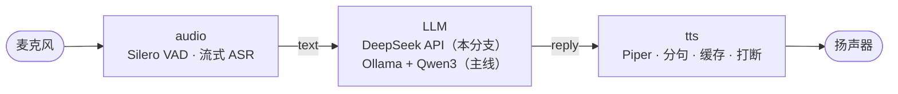

# VoxDesk · 桌面语音助手

> 按住一个键说句话，它**听懂、回答、念出来**。全流程跑在自己的 Windows 电脑上，不依赖任何语音云服务。
>
> **实测：ASR 218ms · 首 token 681ms · 到首字 ≈1.05s · 打包后 463MB（模型内置）**

`Windows 10/11 x64` · `Python 3.11` · `ONNX Runtime` · `CPU 即可，不需要独显`

---

## 它是什么

一个**本地化程度很高**的语音对话应用：

- **语音不出本机**——识别（ASR）与播报（TTS）都在本地跑，模型是 226MB + 60MB 的 ONNX 文件
- **按一下就能用**——`F2` 按下说话、松开出结果，不挑窗口焦点，不装驱动
- **能打包发人**——`build.ps1` 生成 463MB 的免安装目录，双击 exe 就能跑

当前分支接的是 **DeepSeek API**（只把**文本**发出去，音频不出本机）；主线版本接本地 Ollama，可完全离线。差异见下表。

## 立刻试用

```powershell
git clone https://github.com/<you>/VoxDesk.git
cd VoxDesk\demo

uv sync                                         # 装依赖（自动装 Python 3.11）
Copy-Item .env.example .env                     # 填 DEEPSEEK_API_KEY=
uv run python scripts/voice_chat.py             # 按住 F2 说话
```

没有 key 也能先看链路：

```powershell
uv run python scripts/voice_chat.py --file ..\audio\out\corpus\01.wav --mock
```

## 能力

| 能力 | 实测 / 说明 |
| --- | --- |
| 中文流式识别 | sherpa-onnx Paraformer，**首字 218ms**，标点自动补 |
| 对话 | DeepSeek Chat，SSE 流式，**首 token 681ms** |
| 语音播报 | Piper 本地合成，**实时因子 0.026**；分句 + 缓存，同句第二次直接命中 |
| 打断 | `stop()` 后 **12–39ms** 真静音 |
| 断句（VAD） | Silero VAD，50 句验收 **切错 0 条**，起点误差 64ms |
| 降噪 | 谱减 + bypass 开关；0 dB 白噪下端点错误 **1 → 0** |
| 免安装分发 | PyInstaller 打包 **463MB**，模型内置，双击即用 |

## 它是怎么搭的



三个目录各是一块可独立验收的切片：

| 目录 | 内容 | 验收 |
| --- | --- | --- |
| `audio/` | 采集、VAD 端点、降噪、PTT、流式 ASR | 50 句切错 0；首字 218ms |
| `tts/` | Piper 播报、分句、缓存、打断、引擎可替换 | 首音 56ms；打断 12ms |
| `demo/` | 把两者拼成一轮对话，LLM 适配 + 打包 | 到首字 ≈1.05s；exe 463MB |

每个目录都有自己的 README，写清了踩过的坑与实测数据：

- [`demo/README.md`](demo/README.md) — 功能、用法、后续方向
- [`audio/README.md`](audio/README.md) — 端点/降噪的实测与"64 点上下文"坑
- [`tts/README.md`](tts/README.md) — 分句/缓存/打断，以及"换引擎不改调用方"的证明

## 环境要求

| 项 | 要求 |
| --- | --- |
| 系统 | Windows 10/11 x64 |
| Python | 3.11（`uv` 自动安装） |
| 硬件 | 有麦克风即可，CPU 跑得动 |
| 网络 | 只有调 API 时需要；`--mock` 完全离线 |
| 磁盘 | 源码 + 模型约 400MB；打包产物 463MB |

## 打包成免安装应用

```powershell
cd demo
.\build.ps1
```

产物 `demo\dist\VoxDeskVoice\`：双击 `VoxDeskVoice.exe`；分发给别人时压缩整个文件夹，对方填好 `.env` 即可。

## 这个分支与主线的差异

| 项 | 本分支（demo） | 主线 |
| --- | --- | --- |
| LLM | DeepSeek API | Ollama + Qwen3-4B（离线） |
| 隐私 | 文本出本机 | 全本地 |
| 首 token | 681ms（实测） | 目标 ≤1.2s |
| 目的 | 先看到"能对话"的体感 | 按文档逐步落地 |

主线的架构、需求、选型与决策记录在**另建的文档仓**（`full-deplux dialogue system`）：C4 架构图、60 条需求、ADR 决策、以及每个里程碑的验收数据。

## 路线

- **近期**：常开麦 + VAD 自动断句（免按键）、流式播报（首段合成完就播）、`Esc` 打断
- **中期**：本地/云端一键切换、多轮记忆、工具调用（开程序 / 查天气）、托盘常驻
- **不做**：全双工与回声消除（独立量级）、自研模型、重写 GUI

## 说明

这是个人求职项目：重点在**端侧工程与系统编排**，不在训练模型。
所有数字都来自本机实测，出处与复现命令写在各目录的 README 里。
