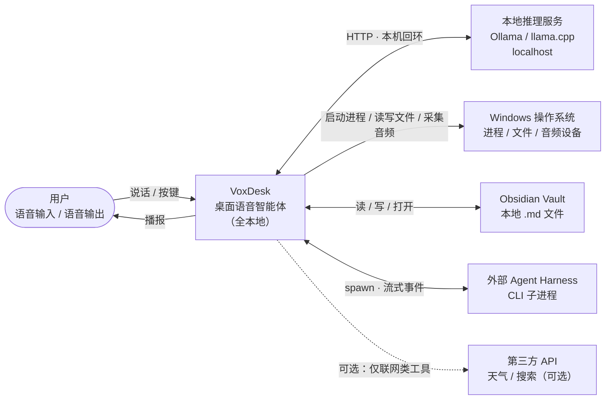
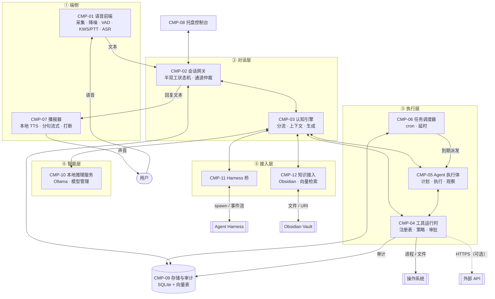

# VoxDesk · 桌面语音智能体

> 一个跑在 PC 上的语音对话 Agent：**全本地推理，断网可用**。听懂人话 → 开程序 → 查笔记 → 排定时任务 → 把复杂活儿转给编码 agent。
> **本仓库是工程文档仓库，架构先于代码。** 原型阶段以图交付，不含实现。

| 项 | 值 |
| --- | --- |
| 当前版本 | **v0.10.0（README 上架构总览与 C4 图）** |
| 文档定稿 | 2026-11-04 19:30 +08:00 |
| 当前阶段 | M0.5 · TTS 模块 —— **S1 完成**，下一步 S2（换 Piper，验"可替换"） |
| 代码状态 | **跑通 S0+S1**：`D:\VoxDesk\tts` v0.2.0（首音 91ms / 打断 38.8ms / 13 个单测） |
| 关键技术决策 | 本地优先、半双工先行、自研语音管线、委托 harness |

---

## 1. 一句话讲清这个项目

借小爱同学的**功能形态**、OpenClaw 的**工程分层**，做一个能在自己电脑上干活儿的语音入口：
说话 → 理解 → **真的把事办了**（开程序 / 查笔记 / 定闹钟 / 把难活转给 agent），再把结果说给你听。

**差异化**：小爱离不开云，OpenClaw 离不开云模型，这个项目**用嘴、离线、在本机干活**。

参考对象：

- **小爱同学** —— 功能形态与端侧工程（唤醒、降噪、技能路由、定时提醒）
- **OpenClaw** —— 系统分层与生态集成（Gateway / Runtime / Tools / Cron / 审批）

详见 [docs/06-reference-landscape.md](docs/06-reference-landscape.md)。

## 2. 系统一览

> 两张图看懂：**它和谁打交道**（C4-L1 上下文）与**内部怎么分层**（C4-L2 容器）。
> 组件职责、6 条时序、半双工状态机、领域类图在 [docs/03-architecture.md](docs/03-architecture.md)。

### 2.1 C4-L1 · 系统上下文

**读法**：唯一那条虚线是外部 API——离线时**允许失败**，且必须有降级话术。其余五条全是本机依赖，断网不影响。

### 2.2 C4-L2 · 容器图

5 层 + 2 个支撑件，**同进程**；只有推理服务是独立进程（HTTP 回环，便于换引擎）。

**读法**：主链路只有一条——`用户 → CMP-01 → CMP-02 → CMP-03 →（工具 / 规划 / 委托）→ CMP-07 → 用户`。`CMP-09` 是纵切面，所有组件都往里写审计；`CMP-08` 只读不写，用来"看得见它在干嘛"。

### 2.3 12 个组件与当前进度

| 层 | 组件 | 一句话职责 | 进度 |
| --- | --- | --- | --- |
| ① 端侧 | `CMP-01` 语音前端 | 把声音变成一句可靠的文本 | ⬜ 未开工（M1） |
| ① 端侧 | `CMP-07` 播报器 | 把文本变成声音，能被按键叫停 | 🟡 **S0+S1 已跑通，S2 待做** |
| ② 对话 | `CMP-02` 会话网关 | 管住"这一轮走到哪了"，仲裁音频通道 | ⬜ 未开工 |
| ② 对话 | `CMP-03` 认知引擎 | 决定这句话该干什么，并组织语言 | ⬜ 未开工 |
| ③ 执行 | `CMP-04` 工具运行时 | 唯一真正"动手"的地方 | ⬜ 未开工 |
| ③ 执行 | `CMP-05` Agent 执行体 | 把复合任务拆成可执行步骤 | ⬜ 未开工 |
| ③ 执行 | `CMP-06` 任务调度器 | 记住"什么时候该叫醒谁" | ⬜ 未开工 |
| ④ 智能 | `CMP-10` 本地推理服务 | 把模型跑起来，并管理其生命周期 | ⬜ 未开工 |
| ⑤ 接入 | `CMP-11` Harness 桥 | 把复杂任务翻译成对 harness 的调用 | ⬜ 未开工 |
| ⑤ 接入 | `CMP-12` 知识接入 | 把本地笔记变成可检索的知识 | ⬜ 未开工 |
| 支撑 | `CMP-08` 托盘控制台 | 让人看得见它在干嘛 | ⬜ 未开工 |
| 支撑 | `CMP-09` 存储与审计 | 保证一切可追溯、可恢复 | ⬜ 未开工 |

图例：✅ 已验收 · 🟡 进行中 · ⬜ 未开工。**进度以代码仓 `D:\VoxDesk` 的 git tag 为准**，本文每月对齐一次。

> **镜像规则**：§2.1 / §2.2 与 [`docs/03-architecture.md`](docs/03-architecture.md) §2/§3 是**同一张图的两处渲染**，`diagram ID` 与 `updated` 必须一致；改图两处一起改，冲突时以 `03` 为准（`00-spec.md` §7.3）。
> **为什么放 README**：门面要让新读者 30 秒内看到"它长什么样"；但**权威版本在 `03`**，这里只是镜像。

## 3. 文档地图

| 文件 | 内容 | 状态 |
| --- | --- | --- |
| [AGENTS.md](AGENTS.md) | **给编码 agent 的操作规约**：改动顺序、禁止事项、环境、未决项指针 | 现行 |
| [docs/00-spec.md](docs/00-spec.md) | **文档规范**：版本、时间戳、编号、图规范（含 README 镜像规则）、ADR 生命周期 | 待确认（v0.2.1） |
| [docs/01-scope.md](docs/01-scope.md) | 范围、场景、非目标、成功标准 | v0.2.0 |
| [docs/02-requirements.md](docs/02-requirements.md) | 需求池 60 条（REQ-F/N/C）+ 验收标准 | v0.2.0 |
| [docs/03-architecture.md](docs/03-architecture.md) | 架构：5 层、C4、6 张流程图、状态机、类图 | v0.2.0 |
| [docs/04-tech-stack.md](docs/04-tech-stack.md) | **技术栈**：语言、框架、端侧四项、接入层 | v0.2.2 |
| [docs/05-roadmap.md](docs/05-roadmap.md) | 里程碑拆解 M0–M7 | v0.2.0 |
| [docs/06-reference-landscape.md](docs/06-reference-landscape.md) | 小爱 / OpenClaw / 竞品 对照 | v0.2.0 |
| [docs/07-model-layer.md](docs/07-model-layer.md) | **模型层**：选型、运行时、内存预算、工具调用可靠性 | v0.2.0 |
| [docs/08-oss-shortlist.md](docs/08-oss-shortlist.md) | **开源选型**：STT 与系统调用 harness 候选、许可与活跃度 | v0.3.3 |
| [docs/09-tts-module.md](docs/09-tts-module.md) | **TTS 模块**：语言、架构、接口、三阶段实施与首日代码 | v0.4.3 |
| [docs/10-study-route.md](docs/10-study-route.md) | **拆解路线**：9 个仓库的阅读顺序、三遍读法、停止阅读的判据 | v0.5.3 |
| [docs/11-peer-repo-crosscheck.md](docs/11-peer-repo-crosscheck.md) | **同伴仓库核查**：12 条不一致（A/B/C 三级）+ 边界与接缝 | v0.1.1 |
| [docs/12-process.md](docs/12-process.md) | **工程进程**：三轴节奏、四个冲刺、闸门、ADR 触发条件 | v0.1.2 |
| [docs/adr/](docs/adr/) | 架构决策记录（10 份，含 ADR-0010 两仓边界） | — |
| [CHANGELOG.md](CHANGELOG.md) | 版本变更流水（含时间戳） | 现行 |

## 4. 怎么读

1. 先读 [docs/01-scope.md](docs/01-scope.md)，确认做到哪、不做什么；
2. 架构总览在本文 §2，细节（组件职责 / 时序 / 状态机 / 类图）在 [docs/03-architecture.md](docs/03-architecture.md)；
3. 选型理由在 [docs/04-tech-stack.md](docs/04-tech-stack.md) 与 [docs/07-model-layer.md](docs/07-model-layer.md)；
4. 想知道"为什么这么定"，翻 [docs/adr/](docs/adr/)；
5. 这活儿怎么拆、多久做完，看 [docs/05-roadmap.md](docs/05-roadmap.md)；
6. 具体怎么干、学到什么程度停手，看 [docs/12-process.md](docs/12-process.md)。

## 5. 版本记录

| 版本 | 时间 | 摘要 |
| --- | --- | --- |
| v0.10.0 | 2026-11-04 19:30 +08:00 | README 新增 C4-L1 上下文图、C4-L2 容器图与 12 组件进度表；新增"镜像图"规则 |
| v0.9.2 | 2026-11-04 18:55 +08:00 | S1 跑通：分句/缓存/队列/打断；推翻 `09` §7 两处（同步播放打不断、`hash` 不能当缓存键） |
| v0.9.1 | 2026-11-04 18:40 +08:00 | S0 跑通：SAPI 出声 + 落盘；修正 `09` §1.2 的音色记录（中文只有 Huihui Desktop） |
| v0.9.0 | 2026-10-29 15:39 +08:00 | 新增工程进程：交付/学习/决策三轴、S0–S3 冲刺、三道闸门、ADR 只在三种情况写 |
| v0.8.0 | 2026-10-29 15:35 +08:00 | 决策落档：ADR-0010 两仓独立、目标机 16GB 基线；新增 `AGENTS.md` 与 ADR 生命周期规则 |
| v0.7.0 | 2026-10-29 15:12 +08:00 | 新增同伴仓库核查：12 条不一致分级、两仓边界与唯一接缝、答辩口径；补齐 README 版本漂移 |
| v0.6.0 | 2026-10-29 15:10 +08:00 | 三份文档一致性校准：TTS 引擎链统一为四档，补"装不下流式引擎"的边界 |
| v0.4.0 | 2026-10-28 14:35 +08:00 | 新增 TTS 模块设计：三阶段路线、WAV 为界的接口契约、首日可跑代码 |
| v0.3.0 | 2026-10-27 14:40 +08:00 | 新增开源选型清单（STT/系统调用）；核查出 Piper 归档转 GPL 等三项维护性风险 |
| v0.2.0 | 2026-10-26 14:30 +08:00 | 转向本地优先；半双工先行；新增端侧四项、模型层、接入层；需求 39→60 条 |
| v0.1.0 | 2026-10-20 12:12 +08:00 | 建立文档规范、范围、需求池、架构基线、技术栈、里程碑拆解 |

完整流水见 [CHANGELOG.md](CHANGELOG.md)。
