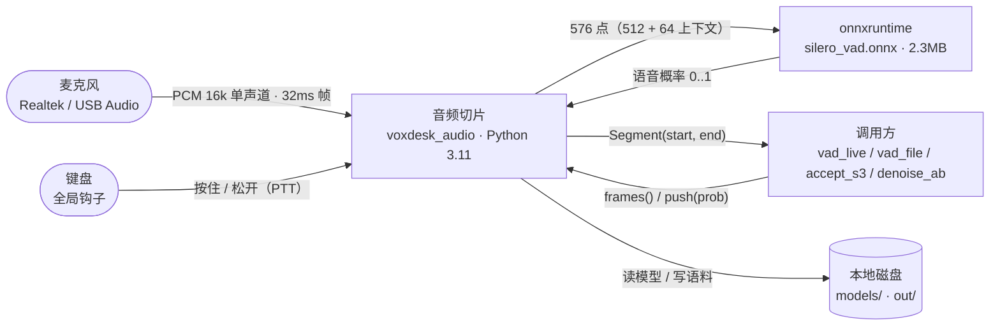
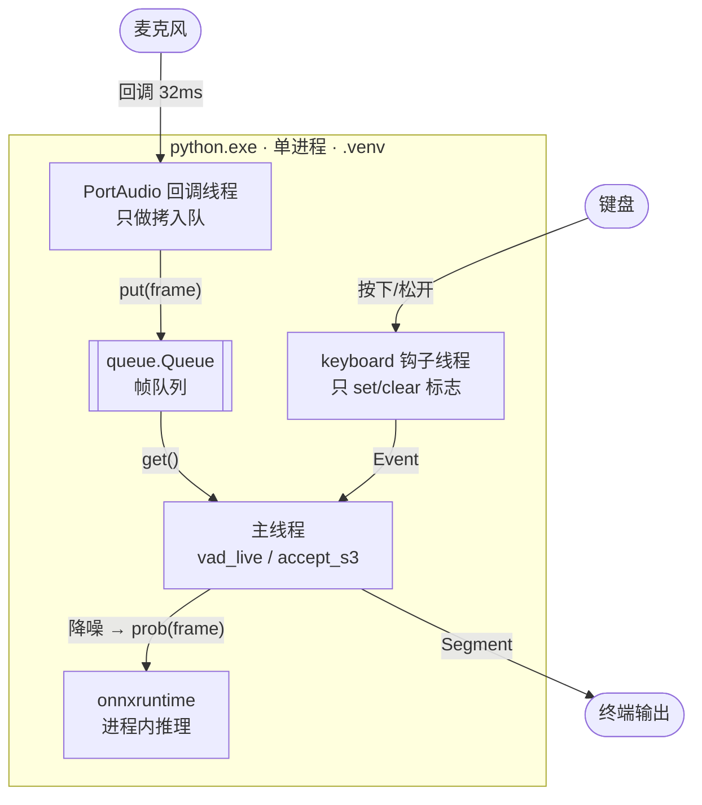
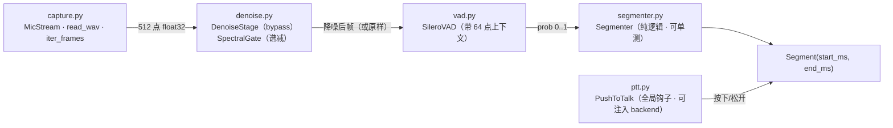

# audio · 端侧音频前端（S3 / M1）

> **S3 已跑通**（2026-11-05）：50 句合成语料，端点 **切错 0 条**（判据 ≤ 5）；降噪与 PTT 已就位。

| 项 | 值 |
| --- | --- |
| 冲刺 | S3 = `M1`（见文档仓 `12-process.md` §3） |
| 职责 | 采集 → 帧 → 降噪（可 bypass）→ Silero VAD 概率 → 端点状态机 → `Segment`；PTT 按住说话 |
| 不做 | ASR（M2 的 sherpa-onnx）、唤醒（M2 的 openWakeWord） |
| 依赖 | `sounddevice` / `numpy` / `onnxruntime` / `keyboard`；模型 `silero_vad.onnx`（2.3 MB，gitignore） |
| 测试 | **15 个单测**（端点 7 + 降噪/PTT 8）+ 2 个验收脚本 |

> **图的编号规则**：切片内部的图用 `<切片>-L1/L2/L3`（`AUD-*`），**不与文档仓的 `CTX-`/`C4-` 共用编号空间**——那两个 ID 已被 `docs/03` 的系统级图占用。

## `AUD-L1` · 上下文（已实现）



**读法**：切片对外只给两样东西——**帧**（来自麦克风或 WAV）和**段落**（来自状态机或 PTT）。它不知道"这句话是什么意思"，那是 M2 的事。

## `AUD-L2` · 运行容器（已实现）



**读法**：三条外部输入（麦克风、键盘、调用方）都只做一件事——**把状态塞给主线程**，推理与打印全在主线程。回调里绝不跑推理（`04` §3.1 的硬规矩）。

## `AUD-L3` · 代码组件（已实现）



**读法**：`denoise` 与 `ptt` 都是**可关、可换、可测**的：前者有 bypass，后者能注入假键盘。`segmenter` 是纯状态机，所以能脱离麦克风测死。

## 实测

### 端点（50 句合成语料，句间 700ms）

| min_silence | 期望 | 检出 | 匹配 | 切错 | 起点误差 |
| --- | --- | --- | --- | --- | --- |
| 300ms | 50 | 50 | 50 | **0** | 64ms |
| 450ms | 50 | 50 | 50 | **0** | 64ms |
| **600ms** | 50 | 50 | 50 | **0** | 64ms |
| 800ms | 50 | 42 | 42 | **8** | 63ms |

800ms 那一行不是缺陷，是参数语义的证明：**静音尾阈值必须小于句间停顿**，否则相邻两句并成一句。

### 降噪 A/B（同一段语音叠白噪，`denoise_ab.py`）

| SNR | 降噪 | 切错 | 分离度（语音帧概率 − 静音帧概率） |
| --- | --- | --- | --- |
| 干净 | off | 0 | +0.903 |
| 干净 | 开 | 0 | +0.889 |
| 10 dB | off | 0 | +0.866 |
| 10 dB | 开 | 0 | +0.868 |
| 5 dB | off | 0 | +0.840 |
| 5 dB | 开 | 0 | +0.861 |
| **0 dB** | off | **1** | +0.783 |
| **0 dB** | 开 | **0** | **+0.849** |

**两条结论**：

1. **噪声越低收益越大**：0 dB 时切错从 1 降到 0、分离度 +0.066；干净音频上反而略降（−0.014）
2. 这正是 `04` §3.3 说的"降噪对近场麦克风收益有限，过度处理会伤语音"——所以**默认 bypass**

> `Brier` 在这次对比里不能作为质量指标：谱减引入 **16ms 延迟**（1 hop），概率曲线整体后移，Brier 会被延迟污染。

## 怎么跑

```powershell
cd D:\VoxDesk\audio
uv sync

# 设备与自测
uv run python scripts/list_devices.py
uv run python scripts/vad_live.py --seconds 3        # 只跑 3 秒，确认能开麦

# VAD 模式
uv run python scripts/vad_live.py                   # 自动断句
uv run python scripts/vad_live.py --denoise          # 开谱减降噪
uv run python scripts/vad_live.py --min-silence 400  # 更灵敏

# PTT 模式（按住说话、松开断句）
uv run python scripts/vad_live.py --ptt f2

# 离线验收
uv run python scripts/accept_s3.py --corpus out/corpus --sweep 300,450,600,800
uv run python scripts/denoise_ab.py --corpus out/corpus --snr inf,10,5,0
```

### 怎么造语料

```powershell
cd D:\VoxDesk\tts
uv run python -c "
from pathlib import Path
from voxdesk_tts import PiperEngine
out = Path(r'D:\VoxDesk\audio\out\corpus'); out.mkdir(parents=True, exist_ok=True)
e = PiperEngine(warmup=True)
for i in range(50):
    e.synth(f'第{i+1}句测试。语音端点检测要判断一句话什么时候开始，什么时候结束。', out / f'{i+1:02d}.wav')
"
```

## 两个坑（都写过注释）

### 1. 512 点喂进去，概率全是 0.00x

Silero 的 ONNX 模型**内部带 64 点上下文**（16k）。正确用法是 `input = concat(context, frame)`（576 点），只喂 512 点**不报错**，但概率全塌：

| 喂法 | max | mean |
| --- | --- | --- |
| 512 点（丢上下文） | 0.323 | 0.004 |
| **576 点（带上下文）** | **1.000** | **0.844** |
| 576 点 · 纯静音 | 0.009 | 0.003 |

### 2. PyPI 上没有可用的 RNNoise

`rnnoise` / `pyrnnoise` 在 PyPI 都不存在，Windows 上要自己编 C 库。所以 `denoise.py` 先上**自研谱减**（纯 numpy、实时、无编译），接口留成 `DenoiseStage(enabled=..., backend=...)`——将来拿到 RNNoise / DeepFilterNet 的库，换 backend 即可，`vad` 与 `capture` 一行不动。

## 已知限制

| 限制 | 影响 | 何时解决 |
| --- | --- | --- |
| 降噪是谱减，不是 RNNoise | 对非稳态噪声（键盘、街道）效果弱 | 拿到 RNNoise/DFN3 的库时换 backend |
| 降噪引入 16ms 延迟 | PTT/VAD 的起点再晚 16ms | 可接受；流式化时一起处理 |
| 端点起点误差 ~64ms | 句首第一个字偶尔被削 | 调大 `speech_pad_ms`（现 100ms） |
| PTT 依赖 `keyboard` 全局钩子 | 受控桌面/远程会话可能装不上 | 失败时退回 VAD 自动断句 |
| 只支持 16k 单声道输入 | 44.1k 设备先重采样 | 够用，不做 |

## 下一步

M2：`sherpa-onnx` + Paraformer 流式 ASR 接上，把 `Segment` 变成文本；KWS（openWakeWord）也归 M2。
