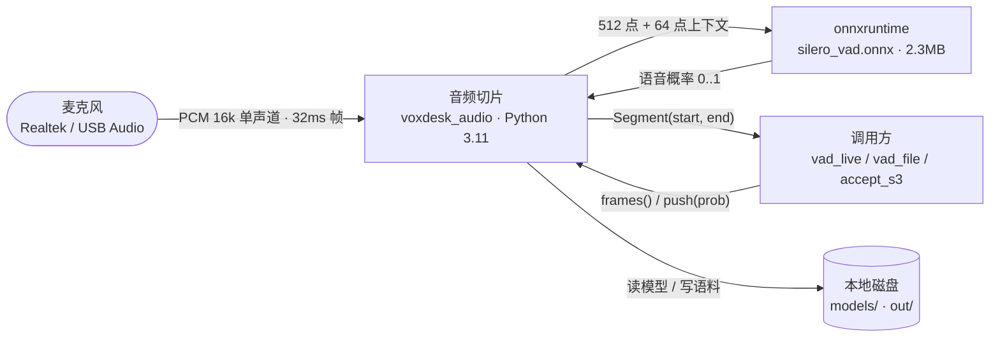
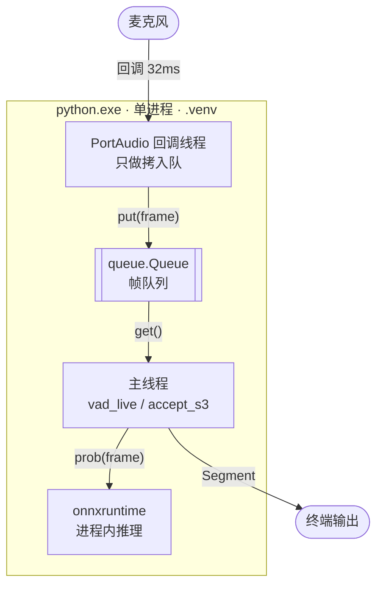
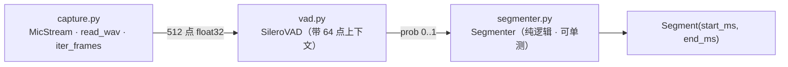

# audio · 端侧音频前端（S3）

> **S3 已跑通**（2026-11-05）：50 句合成语料，端点 **切错 0 条**（判据 ≤ 5）。

| 项 | 值 |
| --- | --- |
| 冲刺 | S3 = `M1`（见文档仓 `12-process.md` §3） |
| 职责 | 采集 → 帧 → Silero VAD 概率 → 端点状态机 → `Segment(start_ms, end_ms)` |
| 不做 | ASR（M2 的 sherpa-onnx）、唤醒（M2 的 openWakeWord）、降噪（本切片先不做，M1 只留接口位置） |
| 依赖 | `sounddevice` / `numpy` / `onnxruntime`；模型 `silero_vad.onnx`（2.3 MB，gitignore） |
| 测试 | 7 个单测（端点状态机）+ 1 个验收脚本（合成语料） |

> **图的编号规则**：切片内部的图用 `<切片>-L1/L2/L3`（`AUD-*`），**不与文档仓的 `CTX-`/`C4-` 共用编号空间**——那两个 ID 已经被 `docs/03` 的系统级图占用，同名不同物是歧义的开始。

## `AUD-L1` · 上下文（已实现）



**读法**：切片只对外给两样东西——**帧**（来自麦克风）和**段落**（来自状态机）。它不知道"这句话是什么意思"，那是 M2 的事。

## `AUD-L2` · 运行容器（已实现）



**读法**：回调线程只做一件事——**拷贝入队**，绝不在回调里跑推理（`04` §3.1 的硬规矩）。推理在主线程，所以 VAD 再慢也不会把音频流拖出溢出。

## `AUD-L3` · 代码组件（已实现）



**读法**：三段各管一件事，且**只有中间那段是有状态的**（RNN state + 上下文）。`segmenter` 是纯函数式状态机，所以能脱离麦克风用合成序列测死（7 个用例）。

## 实测

### 端点验收（50 句合成语料，句间静音 700ms）

| min_silence | 期望 | 检出 | 匹配 | 漏检 | 多检 | 切错 | 起点误差（中位） |
| --- | --- | --- | --- | --- | --- | --- | --- |
| 300ms | 50 | 50 | 50 | 0 | 0 | **0** | 64ms |
| 450ms | 50 | 50 | 50 | 0 | 0 | **0** | 64ms |
| **600ms** | 50 | 50 | 50 | 0 | 0 | **0** | 64ms |
| 800ms | 50 | 42 | 42 | 8 | 0 | **8** | 63ms |

**这张表说明一件事**：`min_silence` 必须**小于句间停顿**。句间 700ms 时，800ms 的阈值会把相邻两句并成一句（漏检 8 条）——这正是半双工"说完等 600ms"这个旋钮的物理含义。

### 单测

`uv run pytest -q` → **7 passed**（短语音被拒、短停顿不断开、长停顿断开、flush 闭合、pad 不为负…）。

## 怎么跑

```powershell
cd D:\VoxDesk\audio
uv sync

uv run python scripts/list_devices.py        # 看输入设备
uv run python scripts/vad_live.py            # 对着麦克风说话，实时打印端点
uv run python scripts/vad_live.py --seconds 3  # 只跑 3 秒（自测）

uv run python scripts/vad_file.py out/corpus/01.wav --bar   # 单文件 + 概率条

uv run python scripts/accept_s3.py --corpus out/corpus --sweep 300,450,600,800
```

### 怎么造语料

验收要"已知起止"的音频，所以用 TTS 合成（`tts` 工程，Piper）：

```powershell
cd D:\VoxDesk\tts
uv run python -c "
from pathlib import Path
from voxdesk_tts import PiperEngine
out = Path(r'D:\VoxDesk\audio\out\corpus'); out.mkdir(parents=True, exist_ok=True)
e = PiperEngine(warmup=True)
for i in range(50):
    e.synth(f'第{i+1}句测试。语音端点检测要判断一句话什么时候开始，什么时候结束。', out / f'{i+1:02d}.wav')
"
```

## 最大的坑：512 点喂进去，概率全是 0.00x

Silero 的 ONNX 模型**内部带 64 点上下文**（16k）。正确用法是：

```
input = concat(context[-64:], frame[512])   → (1, 576)
context = input[-64:]
```

只喂 512 点**不会报错**，但概率会全塌到 0.00x——看起来像"永远没人说话"，很容易误判成"模型坏了"或"麦克风坏了"。

实测对照（同一段 5.1s 中文）：

| 喂法 | max | mean |
| --- | --- | --- |
| 512 点（丢上下文） | 0.323 | 0.004 |
| **576 点（带上下文）** | **1.000** | **0.844** |
| 576 点 · 纯静音 | 0.009 | 0.003 |

## 已知限制

| 限制 | 影响 | 何时解决 |
| --- | --- | --- |
| 没有降噪 Stage | 噪声环境下 VAD 会抖，端点前后拖尾 | M1 收尾（RNNoise + bypass 开关） |
| 没有 PTT 热键 | 只能靠 VAD 自动断句 | M1 收尾（`keyboard` 全局热键） |
| 端点起点误差 ~64ms | 句首第一个字偶尔被削 | 调大 `speech_pad_ms`（现 100ms） |
| 只支持 16k 单声道输入 | 44.1k 设备会先重采样 | 够用，不做 |

## 下一步

M1 收尾：降噪 Stage（RNNoise，带 bypass）、PTT 热键、与 `CMP-02` 的通道仲裁对接。
