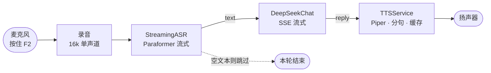

# VoxDesk Voice Demo · 语音对话闭环

> ⚠️ **只存在于分支 `demo/deepseek-voice`**。主线（`master`）的 S5 接的是本地 Ollama + Qwen3-4B
> （见 `docs/13-M2process.md`）；这条分支把 LLM 换成 **DeepSeek API**，只为先跑通"能对话"的体感。

按住 `F2` 说一句话，松开后它会：**听懂 → 回答 → 念出来**。

实测（本机，真 API）：**ASR 218ms · 首 token 681ms · 到首字 ≈1.05s**；打包后 **463 MB**（模型内置）。

---

## 一、应用功能简介

### 能做什么

| 能力 | 说明 |
| --- | --- |
| **按住说话** | `F2` 按下录音、松开即出结果；不需要点按钮、不挑窗口焦点 |
| **中文语音识别** | sherpa-onnx 流式 Paraformer，首字约 0.2–0.3s，标点自动补 |
| **对话** | DeepSeek Chat，SSE 流式；回答长度被 system prompt 约束为"两句话内、不带 Markdown" |
| **语音播报** | Piper 本地合成（RTF 0.026）+ 缓存；同一句第二次直接命中 |
| **不花钱验链路** | `--mock` 用固定回复走完 ASR → TTS，不调 API |
| **免安装分发** | 打包成 463MB 的文件夹，双击 exe 即可运行（模型内置） |

### 链路



### 三个模块从哪来

| 模块 | 来源 | 状态 |
| --- | --- | --- |
| `voxdesk_audio`（ASR、麦克风、VAD、PTT） | 主线 S3/S4 切片 | 已跑通，50 句端点验收 0 错 |
| `voxdesk_tts`（Piper 播报、分句、缓存、打断） | 主线 S1/S2 切片 | 已跑通，`service.py` 在换引擎时零改动 |
| `voxdesk_demo`（LLM 适配 + 串联） | **本分支新增** | 两个文件：`llm.py`、`app.py` |

### 与主线的差异（分支存在的理由）

| 项 | 主线 S5 | 本 demo |
| --- | --- | --- |
| LLM | Ollama + Qwen3-4B（本地、离线） | DeepSeek API（云端、需网络） |
| 隐私 | 音频与文本都不出本机 | **只有文本**出本机（ASR 仍本地） |
| 首 token | 目标 ≤1.2s（CPU） | 实测 681ms |
| 依赖 | Ollama 常驻 | 一个 HTTP 客户端（标准库实现） |

---

## 二、使用说明

### 环境要求

| 项 | 要求 |
| --- | --- |
| 系统 | Windows 10/11 x64（用到 WASAPI 与全局热键） |
| Python | 3.11（`uv` 会自动装，不用手动配） |
| 硬件 | 有麦克风；CPU 即可（本项目全程不要求独显） |
| 网络 | 只有调 API 时需要；`--mock` 完全离线 |

### 安装

```powershell
cd D:\VoxDesk\demo
uv sync          # 会把 audio / tts 两个切片作为本地依赖一起装
```

模型放在各自切片里（`audio/models/`、`tts/models/`），`uv sync` 不会下载它们——缺了会提示路径与下载链接。

### 配置密钥（三选一）

```powershell
# A. 临时：只活当前窗口
$env:DEEPSEEK_API_KEY = "sk-..."

# B. 写文件：推荐，一次配好长期用
Copy-Item .env.example .env
notepad .env          # 填 DEEPSEEK_API_KEY=
```

优先级：**命令行 `--key` > 环境变量 > `.env`**。`.env` 已被根 `.gitignore` 忽略，不会提交。

### 三种运行方式

| 命令 | 用途 | 需要麦克风 |
| --- | --- | --- |
| `uv run python scripts/voice_chat.py --file ..\audio\out\corpus\01.wav --mock` | 用现成 wav 验链路，不花钱 | 否 |
| `uv run python scripts/voice_chat.py --seconds 4` | 固定录 4 秒 | 是 |
| `uv run python scripts/voice_chat.py` | 按住 `F2` 说话（默认） | 是 |

常用参数：

| 参数 | 说明 |
| --- | --- |
| `--mock` | 不调 API，用固定回复 |
| `--key` / `--model` | 覆盖 key / 模型名 |
| `--system` | 覆盖 system prompt（默认要求"两句话内、不带 Markdown"） |
| `--ptt f3` | 换一个按住说话的键 |
| `--device 2` | 指定输入设备（编号见 `audio/scripts/list_devices.py`） |
| `--models D:\models` | 覆盖模型目录 |

### 打包成免安装应用

```powershell
.\build.ps1
```

产物 `dist\VoxDeskVoice\`（约 463MB）：

```
VoxDeskVoice\
├─ VoxDeskVoice.exe      ← 双击运行（控制台窗口）
├─ models\               ← ASR 226MB + Piper 60MB + VAD 2.3MB
├─ .env.example          ← 拷成 .env 填 key
└─ _internal\            ← Python 运行时与依赖
```

分发：**压缩整个文件夹** → 对方解压 → 复制 `.env.example` 为 `.env` 填 key → 双击 exe。
发人之前记得删掉 `dist\VoxDeskVoice\.env`（如果你在里面填过真 key）。

### 常见问题

| 现象 | 原因 / 处理 |
| --- | --- |
| `HTTP 401` | key 无效或过期；报错里会显示 key 尾号，便于确认用的是哪一个 |
| `没有 API key` | 三处都没配：`--key`、环境变量、`.env` |
| `找不到 ASR 模型目录` | 模型没下；按报错里的链接下载后解压到提示路径 |
| SmartScreen 拦截 | exe 未签名：点"更多信息 → 仍要运行" |
| 第一个字被削 | 按住后才开麦（约 50ms 开销）；说之前先按住再开口 |
| 没有声音 | 输出设备不是默认设备；或 TTS 被系统静音 |

---

## 三、后续更新方向

### 近期（1–2 周）

| 方向 | 为什么 | 做法 |
| --- | --- | --- |
| **常开麦 + VAD 自动断句** | 现在要按键，不像"助手" | 直接用 `audio` 的 `Segmenter`；说完自动停，不用按键 |
| **流式播报** | 现在等整句合成完才开口 | 现已按 50 字切段；下一步把"首段合成完就播"提前到 LLM 流式输出 |
| **随时打断** | 它说错了只能等它说完 | 按 `Esc` 调 `TTSService.stop()`（该能力 S1 已验证，39ms 静音） |

### 中期

| 方向 | 说明 |
| --- | --- |
| **本地/云端可切换** | `--llm local|deepseek`：本地走 Ollama（离线性），云端走 API（速度） |
| **多轮记忆** | 现在只带 6 条历史；加滚动摘要 + 硬截断 |
| **工具调用** | 让它能"打开记事本""查天气"，用 DeepSeek 的 function calling 先验证协议 |
| **托盘常驻** | 从控制台窗口变成后台进程 + 热键唤醒 |

### 明确不做

| 不做 | 原因 |
| --- | --- |
| 全双工 / AEC | 独立量级（`docs/01-scope.md` 列为 P3）；demo 用按键已够 |
| 自研模型 / 微调 | 价值在编排，不在训练 |
| 重写 GUI | 语音是主通道；要图形界面也只用托盘 |

---

## 附：本分支的提交

```
4914f3e  feat(demo): 打包成可分发 Windows 应用
abb4b25  feat(demo): .env 支持 + gitignore 忽略密钥
a0c5be2  feat(demo): 语音->ASR->DeepSeek->TTS 临时 demo
```

回主线：`git checkout master`（本目录会消失，提交仍在分支里）。
