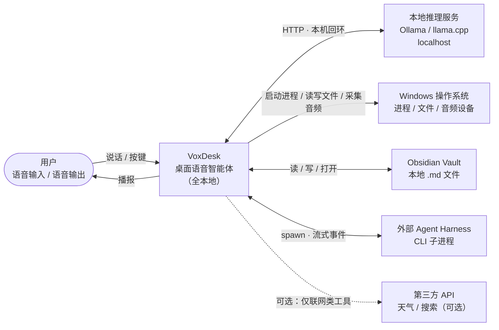
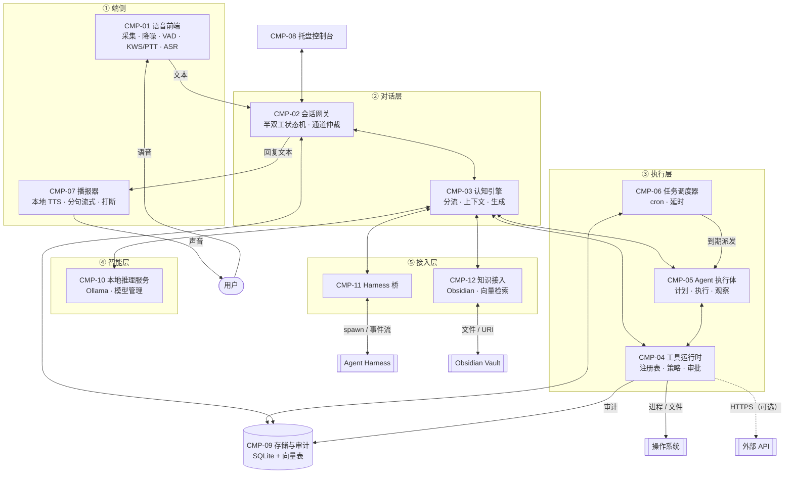
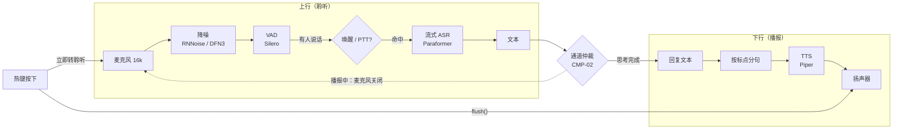
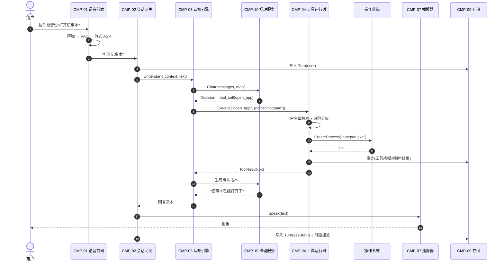
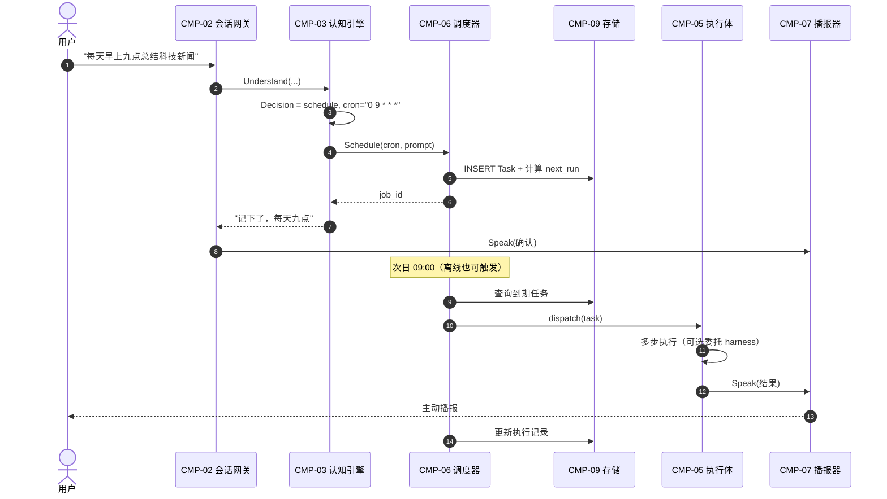
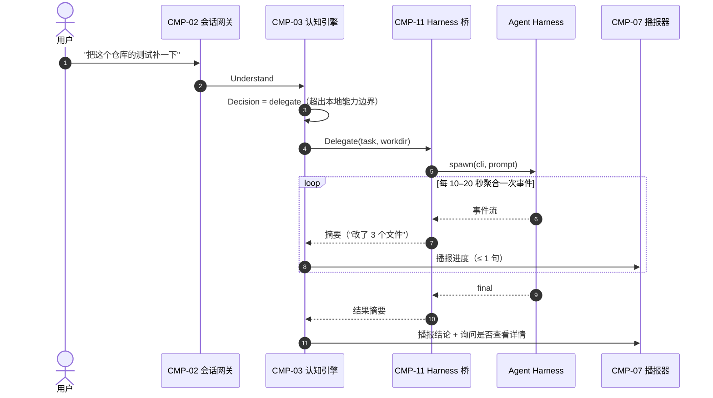
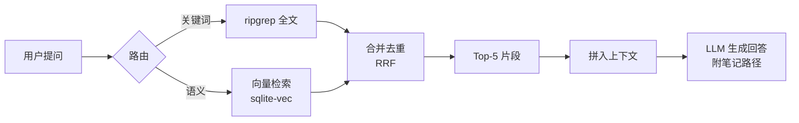
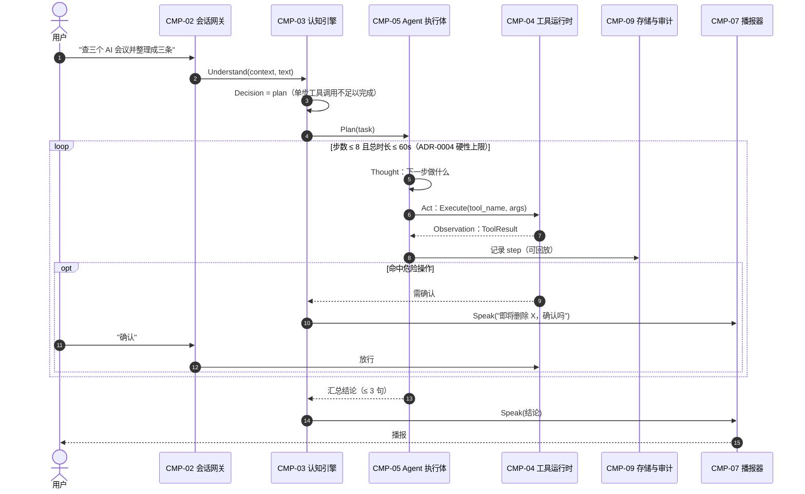
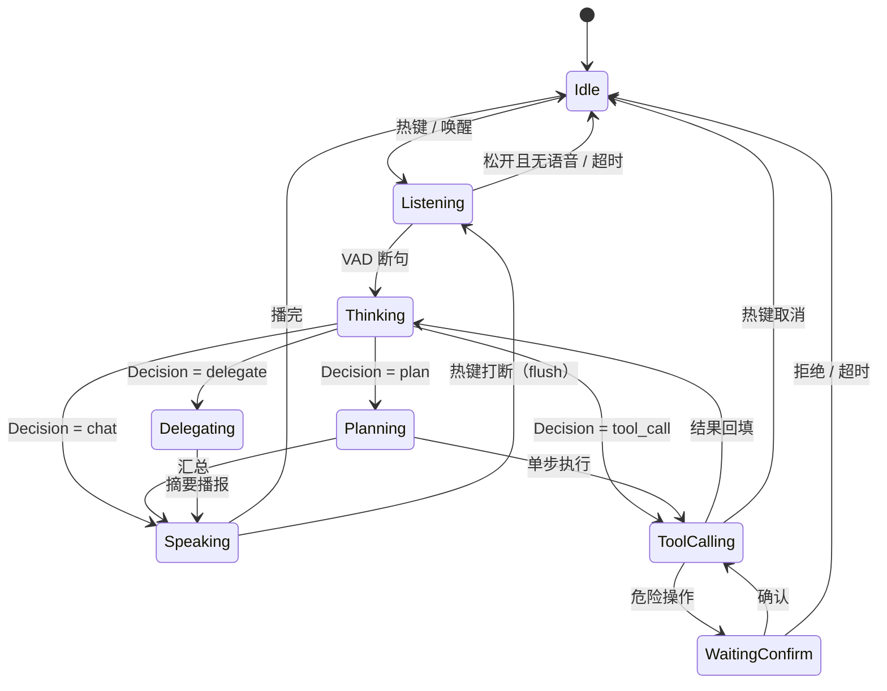
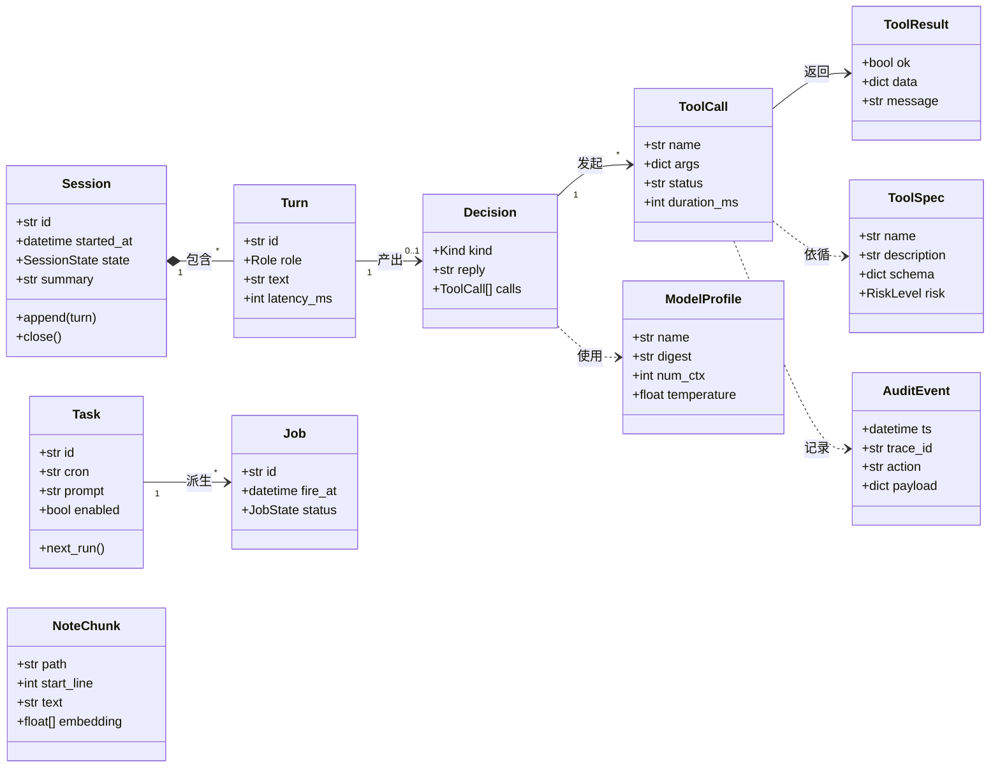

# 03 · 架构

| 字段 | 值 |
| --- | --- |
| 文档 | `docs/03-architecture.md` |
| 版本 | v0.3.0 |
| 状态 | 草案 |
| 更新 | 2026-11-11 22:05 +08:00 |
| 生效范围 | 组件划分、交互流程、状态、领域模型 |

> **本版变化**：逻辑分层由"9 个平铺组件"改为 **5 层 + 2 个跨层基础件**；语音链路由"云"改为"本机"；会话模型由"全双工"改为"半双工 + 通道仲裁"。

---

## 1. 架构原则

| # | 原则 | 含义 | 违反的典型症状 |
| --- | --- | --- | --- |
| 1 | **单向数据流** | 音频 → 文本 → 意图 → 执行 → 文本 → 音频，不回环 | 组件互相直调，改一处崩三处 |
| 2 | **一切能力皆工具** | 开程序、调 API、查笔记，走同一套 Tool 接口 | if-else 越写越长 |
| 3 | **状态可持久化** | 会话、任务、审计全落库，进程可随时死 | 重启后任务消失，无法复盘 |
| 4 | **危险操作默认拦截** | 白名单 + 风险分级 + 二次确认 | 一句"删了吧"把目录删了 |
| 5 | **模型可替换** | 编排只依赖抽象接口，不绑厂商 | 换模型要改半个项目 |
| 6 | **离线优先** | 任何组件不得隐含依赖公网 | 断网即残废 |

## 2. C4-L1 系统上下文

> 唯一的虚线是外部 API——它在离线时**允许失败**，且必须有降级话术。

## 3. C4-L2 容器图

5 层 + 2 个基础件，同进程；只有推理服务是独立进程（便于换引擎）。

### 3.1 组件职责

| ID | 组件 | 职责（一句话） | 关键输入 → 输出 |
| --- | --- | --- | --- |
| CMP-01 | 语音前端 | 把声音变成一句可靠的文本 | 音频帧 → `text` |
| CMP-02 | 会话网关 | 管住"这一轮走到哪了"，并仲裁音频通道 | 事件 → 状态迁移 |
| CMP-03 | 认知引擎 | 决定"这句话该干什么"并组织语言 | 上下文 + `text` → `Decision` |
| CMP-04 | 工具运行时 | 唯一真正"动手"的地方 | `tool_call` → `ToolResult` |
| CMP-05 | Agent 执行体 | 把复合任务拆成可执行步骤 | 任务描述 → 步骤与结论 |
| CMP-06 | 任务调度器 | 记住"什么时候该叫醒谁" | cron / delay → 到点派发 |
| CMP-07 | 播报器 | 把文本变成声音，且能被按键叫停 | `text` → 音频流 |
| CMP-08 | 托盘控制台 | 让人看得见它在干嘛 | 状态 / 配置 |
| CMP-09 | 存储与审计 | 保证一切可追溯、可恢复 | 事件 → 持久化 |
| **CMP-10** | **本地推理服务** | 把模型跑起来，并管理其生命周期 | `messages + tools` → 流式 token |
| **CMP-11** | **Harness 桥** | 把复杂任务翻译成对 harness 的调用 | 任务 → 摘要事件流 |
| **CMP-12** | **知识接入** | 把本地笔记变成可检索的知识 | 查询 → 片段 + 引用 |

### 3.2 关键接口

| ID | 接口 | 定义方 | 说明 |
| --- | --- | --- | --- |
| IF-01 | `SpeechToText(audio_stream) -> text_stream` | CMP-01 | 流式，首字优先 |
| IF-02 | `Understand(context, text) -> Decision` | CMP-03 | `Decision` ∈ {chat, tool_call, plan, schedule, delegate, clarify} |
| IF-03 | `Execute(tool_name, args) -> ToolResult` | CMP-04 | 成功 / 失败 / 需确认 三态 |
| IF-04 | `Schedule(cron \| delay, payload) -> job_id` | CMP-06 | 持久化后返回 |
| IF-05 | `Speak(text_stream) -> PlaybackHandle` | CMP-07 | `flush()` 可中断 |
| **IF-06** | **`Delegate(task, workdir) -> event_stream`** | **CMP-11** | **摘要级事件，非逐字** |
| **IF-07** | **`Search(query, k) -> Chunk[]`** | **CMP-12** | **带来源路径与行号** |
| **IF-08** | **`Chat(messages, tools) -> token_stream`** | **CMP-10** | **OpenAI 兼容** |

## 4. 核心流程

### 4.1 FLOW-04 端侧音频链路（半双工的核心）

半双工的本质不是"不能同时"，而是**一个显式的通道仲裁器**：任一时刻只允许上行或下行之一活跃。

**三个关键设计**：

1. **播报时麦克风关闭** → 不需要 AEC，这是半双工最大的工程红利
2. **热键是全局的逃生口** → 任何时刻按下都能停止播报并转入聆听
3. **ASR 只走一次** → 不做"边说边识别边说"的回环，避免自激

### 4.2 FLOW-01 主链路（一次即时执行）

### 4.3 FLOW-02 定时任务

### 4.4 FLOW-05 委托 Harness

### 4.5 FLOW-06 知识检索

### 4.6 FLOW-03 Agent 执行体（ReAct 多步计划）

`FLOW-01` 只覆盖"一次工具调用就结束"的情形；需要**多轮 思考 → 行动 → 观察**的请求（`REQ-F-040`~`REQ-F-043`）由 `CMP-05` 接管，
决策依据见 `ADR-0004`。`CMP-03` 只决定"要 plan"，不亲自执行循环。

**硬性上限**（`ADR-0004`）：步数 ≤ 8、总时长 ≤ 60 s；任一上限触发即中止，并播报"已经做了 N 步，还差什么"，
不静默失败。危险操作**不因"写在计划里"而免确认**——确认点仍在 `CMP-04` 执行前（同 `FLOW-01` 规则）。

### 4.7 SM-01 会话状态机（半双工）

> 注意：**没有** `Speaking → Listening` 的"语音打断"路径，那是全双工；半双工下打断只由热键触发。

### 4.8 DM-01 领域类图

## 5. 数据模型

| 表 | 关键字段 | 用途 |
| --- | --- | --- |
| `sessions` | id, started_at, state, summary | 会话生命周期 |
| `turns` | id, session_id, role, text, latency_ms | 对话流水 |
| `tool_calls` | id, turn_id, name, args_json, status, duration_ms | 工具执行记录 |
| `tasks` | id, cron, prompt, enabled, created_at | 用户定义的周期任务 |
| `jobs` | id, task_id, fire_at, status, result | 触发实例 |
| `audit_events` | ts, trace_id, action, payload_json | 审计与排障 |
| **`note_chunks`** | path, start_line, text, embedding | Obsidian 检索（向量存 `sqlite-vec` 虚表） |

## 6. 时延预算

| 环节 | CPU 4B | GPU 8B | 说明 |
| --- | --- | --- | --- |
| 断句（VAD 静音判定） | 600 ms | 600 ms | 配置项，半双工最大固定开销 |
| ASR 首字 | 400 ms | 350 ms | 流式 |
| LLM 首 token | 900 ms | 400 ms | **CPU 上的头号瓶颈** |
| 工具执行 | 200 ms | 200 ms | 本地启动类 |
| TTS 首包 | 200 ms | 200 ms | Piper 分句流式 |
| **首音合计** | **≈ 2.3 s** | **≈ 1.75 s** | 留 0.5–1s 余量 |

> 若开唤醒词，热键路径省掉 ~0，但用户"说唤醒词→等待"的体感会额外增加 300–500ms。

## 7. 演进：全双工怎么接进来

当前架构不封死全双工，路径清晰：

| 步骤 | 改动 | 影响面 |
| --- | --- | --- |
| 1 | `CMP-01` 增加 `AECStage`（回声消除） | 端侧 |
| 2 | `CMP-02` 状态机增加 `BargedIn` 事件，允许 `Speaking → Listening` | 网关 |
| 3 | 播报时麦克风保持开启，VAD 持续运行 | 通道仲裁 |
| 4 | TTS 支持"边说边被截断"（半句 flush） | 播报器 |

**不在本项目范围内**，列为 P3。写在这里是为了说明：半双工不是妥协，是**分阶段降低风险**。
