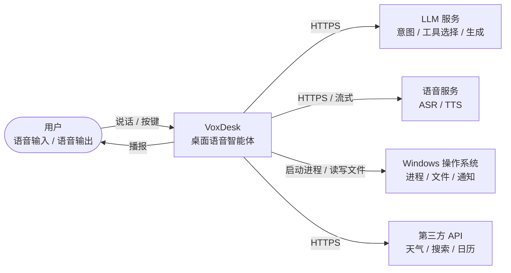
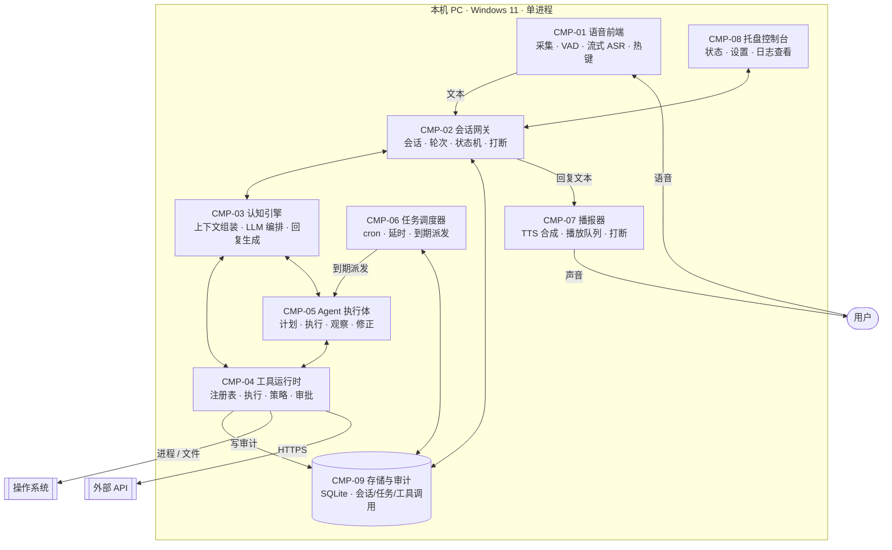
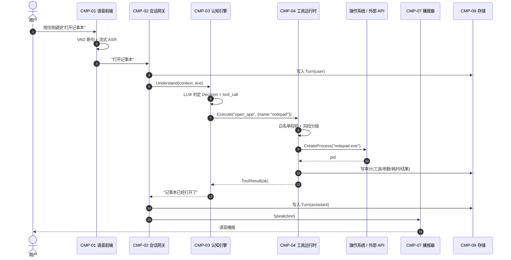
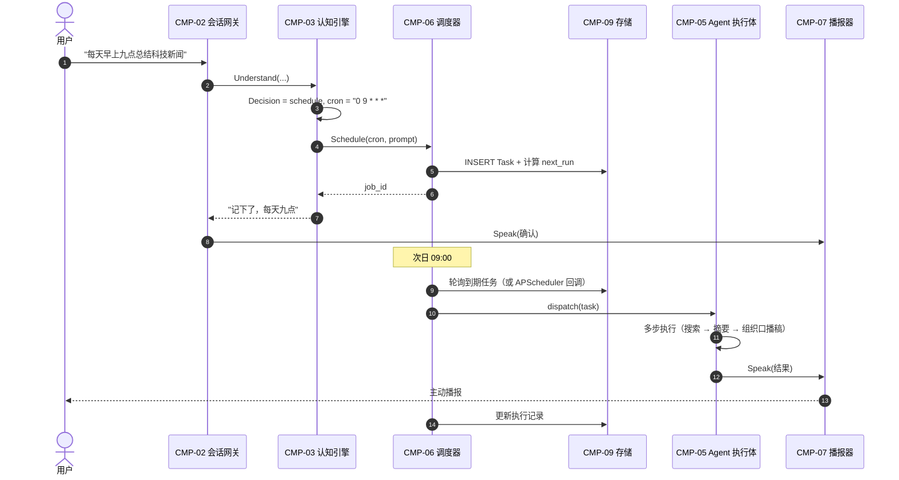
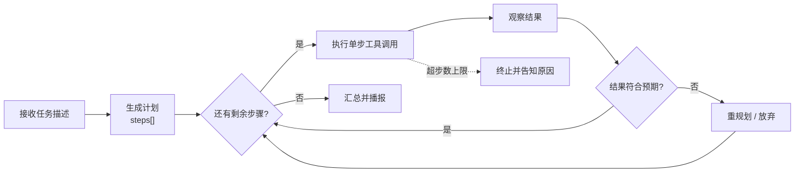
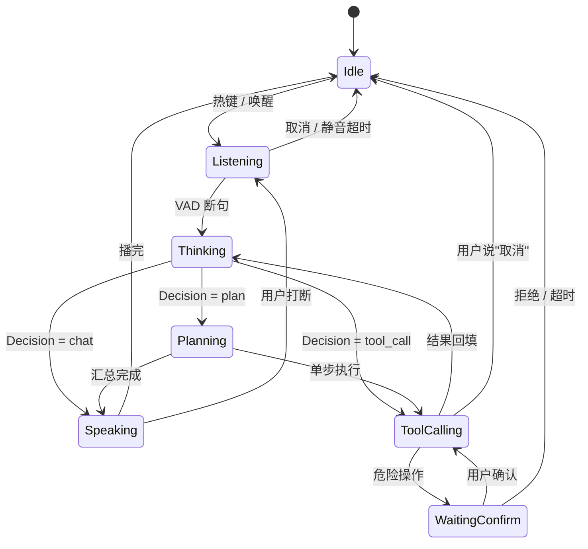
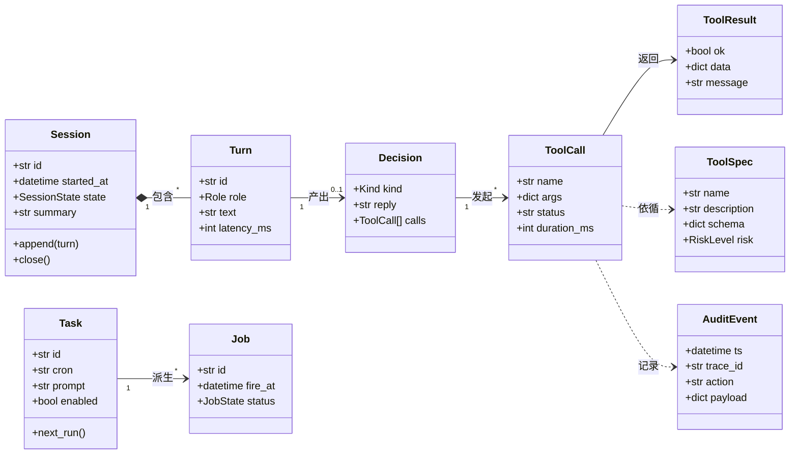

# 03 · 架构

| 字段 | 值 |
| --- | --- |
| 文档 | `docs/03-architecture.md` |
| 版本 | v0.1.0 |
| 状态 | 草案 |
| 更新 | 2026-10-20 12:12 +08:00 |
| 生效范围 | 组件划分、交互流程、状态、领域模型 |

---

## 1. 架构原则

五条原则，后续所有设计冲突都拿它们裁决：

| # | 原则 | 含义 | 违反的典型症状 |
| --- | --- | --- | --- |
| 1 | **事件驱动、单向数据流** | 音频 → 文本 → 意图 → 工具 → 文本 → 音频，不回环 | 组件互相直接调用，改一处崩三处 |
| 2 | **一切能力皆工具** | 开程序、调 API、查文件，全部走同一套 Tool 接口 | if-else 越写越长，新增能力必改编排 |
| 3 | **状态可持久化** | 会话、任务、审计全部落库，进程可随时死 | 重启后任务消失，无法复盘 |
| 4 | **危险操作默认拦截** | 白名单 + 风险分级 + 二次确认 | 一句"删了吧"把目录删了 |
| 5 | **模型可替换** | 编排层只依赖抽象接口，不绑厂商 | 换模型要改半个项目 |

## 2. C4-L1 系统上下文

## 3. C4-L2 容器图

九个组件，全部跑在同一个进程空间内（单机部署，不做服务拆分）。

### 3.1 组件职责

| ID | 组件 | 职责（一句话） | 关键输入 → 输出 |
| --- | --- | --- | --- |
| CMP-01 | 语音前端 | 把声音变成一句文本 | 音频帧 → `text` |
| CMP-02 | 会话网关 | 管住"这一轮对话走到哪了" | `text` / 工具结果 → 状态与下一步 |
| CMP-03 | 认知引擎 | 决定"这句话该干什么"并组织语言 | 上下文 + `text` → 意图 / 工具调用 / 回复 |
| CMP-04 | 工具运行时 | 唯一真正"动手"的地方 | `tool_call` → `result` |
| CMP-05 | Agent 执行体 | 把复合任务拆成可执行步骤 | 任务描述 → 步骤序列与结论 |
| CMP-06 | 任务调度器 | 记住"什么时候该叫醒谁" | cron / delay → 到点派发 |
| CMP-07 | 播报器 | 把文本变成声音，且能被叫停 | `text` → 音频流 |
| CMP-08 | 托盘控制台 | 让人看得见它在干嘛 | 状态 / 配置 |
| CMP-09 | 存储与审计 | 保证一切可追溯、可恢复 | 事件 → 持久化 |

### 3.2 关键接口

| ID | 接口 | 定义方 | 说明 |
| --- | --- | --- | --- |
| IF-01 | `SpeechToText(audio_stream) -> text_stream` | CMP-01 | 流式，首字优先 |
| IF-02 | `Understand(context, text) -> Decision` | CMP-03 | `Decision` ∈ {chat, tool_call, plan, clarify} |
| IF-03 | `Execute(tool_name, args) -> ToolResult` | CMP-04 | 统一成功/失败/需确认三态 |
| IF-04 | `Schedule(cron \| delay, payload) -> job_id` | CMP-06 | 持久化后返回 |
| IF-05 | `Speak(text_stream) -> playback_handle` | CMP-07 | 可中断 |

## 4. 核心流程

### 4.1 FLOW-01 主链路（一次即时执行）

### 4.2 FLOW-02 定时任务（创建 → 触发）

### 4.3 FLOW-03 多步智能体任务

> 循环范式本质是 ReAct（Reason → Act → Observe），但用**步数上限 + 时长上限**兜底，避免在开放式目标上打转。

### 4.4 SM-01 会话状态机

### 4.5 DM-01 领域类图

## 5. 数据模型

| 表 | 关键字段 | 用途 |
| --- | --- | --- |
| `sessions` | id, started_at, state, summary | 会话生命周期 |
| `turns` | id, session_id, role, text, latency_ms | 对话流水 |
| `tool_calls` | id, turn_id, name, args_json, status, duration_ms | 工具执行记录 |
| `tasks` | id, cron, prompt, enabled, created_at | 用户定义的周期任务 |
| `jobs` | id, task_id, fire_at, status, result | 具体触发实例 |
| `audit_events` | ts, trace_id, action, payload_json | 审计与排障 |

## 6. 时延预算（REQ-N-001 的分解）

| 环节 | 目标 | 说明 |
| --- | --- | --- |
| 断句（VAD 静音判定） | 300 ms | 可调 500–800ms，是"自然度"与"响应快"的直接权衡 |
| ASR 首字 | 400 ms | 流式返回，不等整句 |
| LLM 首 token | 600 ms | 意图判定与回复生成可并行 |
| 工具执行 | 300 ms | 本地启动类，不含网络 |
| TTS 首包 | 400 ms | 流式合成，边合成边播 |
| **合计（首音）** | **≈ 2.0 s** | 留 0.5s 余量 |

> 这张表是全双工项目里最值钱的工程资产：**任何"响应慢"的抱怨，都能拆到具体环节去定位**。

## 7. 与 M6 的可选延伸

当前架构不排斥全双工：CMP-01 换成流式双工前端、CMP-02 的状态机增加 `BargedIn` 事件即可。但**不在本项目范围内**，仅作为架构可演进性的说明。
