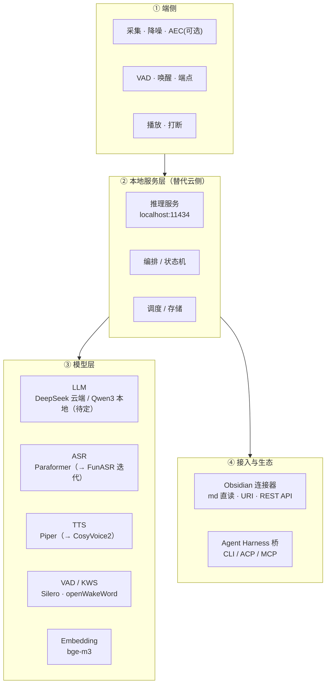

# 04 · 技术栈

| 字段 | 值 |
| --- | --- |
| 文档 | `docs/04-tech-stack.md` |
| 版本 | v0.3.1 |
| 状态 | 部分确认（选型已定；LLM 运行时待定） |
| 更新 | 2026-11-11 22:05 +08:00 |
| 生效范围 | 语言选型、框架选型、四层技术栈落地 |

> **本版重大变化**：由"云优先"改为**本地优先**；由"全双工"改为**半双工先行**。
> 直接结论：**Python 3.11 单语言 + 本地推理全家桶（sherpa-onnx / Ollama / Piper）+ 自研 asyncio 语音管线**。
> 决策依据见 [ADR-0005](adr/ADR-0005-local-first.md)、[ADR-0006](adr/ADR-0006-half-duplex.md)、[ADR-0007](adr/ADR-0007-pipeline-and-runtime.md)。

### 本版决策（2026-11-10，需求方口述，逐条落档）

| 领域 | 决策 | 状态 |
| --- | --- | --- |
| 语音管线 | **自研 asyncio Stage** 为终态；上手阶段可能先用 **Pipecat** 过渡，之后迭代回自研 | 已确认 |
| ASR | 现役 **sherpa-onnx + Paraformer**（已实现）；**性能明显不够**，需先补降噪与评测，随后**迭代 FunASR**；不排除后续基于某个开源软件深度开发 | 已确认（迭代方向） |
| ASR 评测 | 新增 intent：在**普通话 + 英文**场景，用**样本音频 + 参考文字**验证识别结果——统计**缺失字**、**错误字**等（详见 §3.7） | 新增 |
| TTS | 现役 **Piper**（已实现）；**确定迭代 CosyVoice2**，且可能**基于 CosyVoice2 扩展**（不是单纯换引擎） | 已确认 |
| 降噪 | 当前实现是**谱减**（可 bypass）；**RNNoise / DeepFilterNet3 保留为备选**，不排期 | 已确认 |
| LLM 运行时 | **最不确定**：可能继续 **云端 DeepSeek + 提示词工程 + 多轮对话维护**，也可能转 **Ollama 本地**；取决于需求与开发难度 | 待定 |
| 长期 intent | 最终做出一个**类似 neuro-sama 的"智能生命"**（持续在场、有记忆、有性格） | 新增 |

> 因为 LLM 运行时未定，本文档状态记为"部分确认"；`02-requirements.md` 仍保持**草案**（需求优先级待确认）。

---

## 1. 编程语言选择

### 1.1 结论

**主语言：Python 3.11（不用 3.12/3.13）。**

不引入第二语言，除非后续出现明确的性能瓶颈。若需要极限低延迟，再以 **Rust 扩展**替换音频回调，而不是重写整个项目。

### 1.2 为什么是 Python

| 判据 | 说明 |
| --- | --- |
| **端侧模型生态** | Silero VAD、sherpa-onnx、openWakeWord、Piper、FunASR 的**一等公民实现都是 Python**，C++/Rust 侧多为库而非开箱即用的管线 |
| **模型层生态** | Ollama / llama.cpp / vLLM 的客户端、评测脚本、量化工具链以 Python 为主 |
| **接入层成本** | Obsidian vault 就是一堆 `.md` 文件，`pathlib` 直读；harness 多为命令行，`subprocess` 即可驱动 |
| **迭代速度** | 单人业余项目，语言表达力直接换算成工期 |
| **简历信号** | 语音 + LLM 方向，Python 是行业默认，面试官不会追问"为什么不用 X" |

### 1.3 为什么不选其他语言

| 语言 | 否决理由 |
| --- | --- |
| **TypeScript / Node** | 语音与 ONNX 生态弱一档；Windows 下音频库坑多；只有写 Obsidian **插件**才需要，而本项目的 Obsidian 接入用文件系统 + URI 就够 |
| **Rust** | 音频回调与实时性确实更好，但端侧模型推理仍需 ONNX Runtime；开发速度约为 Python 的 1/3，与"业余 3 个月"不匹配 |
| **C++** | 同上，且内存管理成本与单人项目不匹配 |
| **C#** | Windows 原生友好，但语音模型生态几乎为零 |

### 1.4 版本与工程约束

- **Python 3.11**：3.12 起部分 ONNX/音频轮子（`onnxruntime`、`sounddevice` 预编译包）仍有滞后，3.11 兼容性最稳
- 依赖管理：`uv`（推荐）或 `poetry`
- 代码规范：`ruff`（lint + format）、`mypy --strict`（关键路径）
- 并发模型只用 `asyncio`；线程池仅用于阻塞 IO 与推理卸载

---

## 2. 四层技术栈总览

沿用调研计划里的四层框架（端侧 / 云侧 / 模型层 / 接入与生态），但**云侧整层被"本地服务层"替换**。



### 2.1 交付形态（2026-11-10 新增维度）

同一套 Intent，两种 Implement 形态并行存在：

| 维度 | 桌面形态（A 线，原框架） | 浏览器形态（B 线，VoxDesk-Web） |
| --- | --- | --- |
| 入口 | 全局热键 + 托盘 | 网页（`127.0.0.1`），热键仅页面聚焦有效 |
| 音频采集 | `sounddevice` / WASAPI | 浏览器 `getUserMedia` / `getDisplayMedia` |
| ASR / TTS | 进程内模型 | 同一套进程内模型（Python 服务） |
| 推理 | 目标本地 Ollama | 当前云端 DeepSeek（过渡） |
| 状态 | 已实现 M1 + ASR 单点 | 已实现 w0.6 完整对话（见 `09`） |
| 适用 | 离线性、常驻、系统级操作 | 演示、快速迭代、跨设备访问 |

> 两形态共用端侧选型（ASR/TTS 完全一致），差异只在**采集方式**与**推理位置**。这也是后续"回填"的接缝。

## 3. 端侧（重点）

半双工形态下，端侧要独立解决四件事：**听清（降噪）、听准（端点）、听得到（唤醒）、说得出（TTS）**。

### 3.1 音频 I/O 与管线骨架

| 项 | 选型 | 理由 |
| --- | --- | --- |
| 采集/播放 | `sounddevice`（PortAudio） | Windows 下 WASAPI 支持好，回调与流式都支持 |
| 缓冲与帧 | `numpy` float32，帧长 20–32ms | 与 VAD/KWS 输入对齐（Silero 用 512 samples @16k ≈ 32ms） |
| 管线 | **自研 asyncio Frame/Stage**（上手可先用 Pipecat 过渡，后迭代回自研） | 见 [ADR-0007](adr/ADR-0007-pipeline-and-runtime.md)；Pipecat 只作脚手架，避免框架藏住编排逻辑 |
| 采样率 | 采集 16k 单声道；TTS 22.05k | 16k 是 ASR/KWS 标准输入，避免重采样 |
| 全局热键 | `keyboard` | 全局热键最简单；失败时降级为托盘点击 |

**关键工程点**：音频回调线程与事件循环之间用 `asyncio.Queue` + `run_coroutine_threadsafe` 连接；**绝不在回调里做推理**，回调只拷贝入队。

### 3.2 VAD（端点检测）

| 候选 | 形态 | 延迟 | 噪声鲁棒性 | 许可 | 结论 |
| --- | --- | --- | --- | --- | --- |
| **Silero VAD v5** | ONNX ~2MB | 32ms 帧级 | 强 | MIT | ✅ **首选** |
| TEN-VAD | ONNX | 更低 | 强 `[待核]` | `[待核]` | 备选（2025 新模型） |
| webrtcvad | GMM，C 扩展 | 10/20/30ms | 弱（稳态噪声易误判） | BSD | 仅作兜底 |
| 能量门限 | 纯算法 | 0 | 极弱 | — | 双保险 |

```yaml
vad:
  engine: silero_v5
  threshold: 0.5            # 语音概率阈值
  min_speech_ms: 250        # 短于此不算一句话
  min_silence_ms: 600       # 静音尾判定 —— 半双工的主延迟来源
  speech_pad_ms: 100        # 前后补帧，防止切掉字头
```

**坑**：`min_silence_ms` 是"自然度"与"响应快"的直接旋钮。600ms 偏保守（说完有明显停顿感），400ms 偏激进（句中小停会被切断）。做成配置项，M1 用真实语料标定。

### 3.3 降噪

| 候选 | 形态 | CPU 占用 | 适用 | 许可 | 结论 |
| --- | --- | --- | --- | --- | --- |
| **RNNoise** | 10ms 帧，C | 极低 | 稳态噪声（风扇、空调） | BSD-3 | ✅ 常开兜底 |
| **DeepFilterNet3** | ONNX / Torch | 低（实时因子 ~0.05） | 非稳态噪声（键盘、街道） | 需核对 | ✅ 高质模式 |
| speexdsp | C | 极低 | 传统降噪 | BSD | 备选 |
| noisereduce | 频谱门限 | 中 | 离线后处理 | MIT | ❌ 不适合实时 |

**推荐策略**：默认 `RNNoise`，提供 `high` 档切 `DeepFilterNet3`；**必须留 bypass 开关**——降噪对近场麦克风增益有限，过度处理会损伤辅音。

**验证方法**：同一段录音分别以"原始 / RNNoise / DFN3"跑 ASR，比较字错率。用数据定默认档，不靠感觉。

> **2026-11-05 落地结果（S3）**：PyPI **没有** `rnnoise` / `pyrnnoise` 包，Windows 上要自编 C 库。
> 所以先上**自研谱减**（纯 numpy、实时、无编译），接口留成 `DenoiseStage(enabled=…, backend=…)`，
> 将来换 backend 即可，`vad`/`capture` 不动。
> **A/B 实测**（50 句合成语料叠白噪，端点切错）：0 dB 时 **1 → 0**，分离度 +0.066；
> 干净音频上反而略降（−0.014）→ **默认 bypass 的判断被数据证实**。
> 代价：谱减引入 **16 ms 延迟**（1 hop）。详见代码仓 `audio/README.md`。

> **2026-11-10 决策**：**RNNoise / DeepFilterNet3 保留为备选**，不排期；现役就是谱减 + bypass。
> 理由是它在 0 dB 白噪下已把端点切错从 1 压到 0，而 RNNoise 在 Windows 上要自编 C 库、收益未验证。
> 等 §3.7 的 ASR 评测建立后，再用"降噪前后 CER"决定是否升级。

### 3.4 TTS

| 候选 | 形态 | 首包延迟（CPU） | 中文自然度 | 许可 | 结论 |
| --- | --- | --- | --- | --- | --- |
| **Piper**（现 `OHF-Voice/piper1-gpl`） | ONNX，分句流式 | 首音 **56–169ms**；RTF **0.026** | 中等（`zh_CN-huayan`） | **GPL-3.0**（原 MIT 仓库 2025-08 归档） | ✅ **S2 已上线**（模型 60MB，加载 2.23s）；开源分发需评估 |
| MeloTTS | PyTorch | 200–400ms | 较好 | MIT | 备选，替换成本低 |
| Kokoro-82M | ONNX / PyTorch | 150–300ms | 好（中文音色有限） | Apache-2.0 | 备选 |
| CosyVoice 2/3（0.5B） | 流式 LLM-TTS（全栈引擎） | 150ms 流式（README，GPU）；CPU 上 RTF > 1 | 最好（CER 1.21 / SS 78.0；人类 1.26 / 75.5） | Apache-2.0 | ✅ **M6 音质上限**；9 语种 + 18 方言（`08` §3.1） |
| GPT-SoVITS | **应用**（WebUI + 克隆） | RTF 0.53（M4 CPU）/ 0.028（4060Ti） | 最好（可克隆） | MIT | ❌ 是应用不是引擎；克隆场景留到 M6 后（`08` §3.2） |
| Silero TTS | 模型库（`torch.hub`） | 未给数字；CPU 可跑 | ❌ 无中文 | **CC BY-NC 4.0** | ❌ 语种 + 非商用，双重不合格（`08` §3.2） |

**工程要点**：

1. **按标点切句流式合成**，不要等整段文本——首音延迟最大的单点优化
2. 播放队列支持 `flush()`：按键打断时立刻清空并停止
3. 音色、语速、音量可配置；语速 1.05x 在助手场景听感更自然

**2026-11-10 决策**：Piper 为**现役**（已上线）；**CosyVoice2 是确定的迭代目标**，
并且可能**基于 CosyVoice2 扩展**（例如音色克隆、情感控制），而不是把它当"又一个引擎"直接替换。
迁移时机由 §3.7 的评测与 M6 音质需求共同决定。

### 3.5 唤醒

| 候选 | 形态 | 自定义唤醒词 | 误唤醒 | 许可 | 结论 |
| --- | --- | --- | --- | --- | --- |
| **openWakeWord** | ONNX ~1MB，80ms 推理 | 支持自训 | 中 | Apache-2.0 | ✅ **首选** |
| sherpa-onnx KWS | ONNX，流式 | 预置中文词 | 低 | Apache-2.0 | 备选（不想训练时） |
| Porcupine | 商用引擎 | 支持 | 低 | 商用授权 | 效果好但要 license，不划算 |
| microWakeWord | 嵌入式 | 支持 | — | Apache-2.0 | 面向 MCU，PC 上无优势 |

**推荐方案**：`openWakeWord` 自训"你好 Vox" + **二级确认**（唤醒后 1 秒内用 ASR 复核首个词），压住误唤醒。

**验收**：唤醒率 ≥ 95%（安静/有噪各 50 次）；误唤醒 ≤ 1 次/小时。

**排期**：**M2**（2026-11-05 从 M1 移出，与 `12` §3 的 S3 定义对齐）。M1/S3 只到 VAD 端点 + PTT，唤醒详见 `05` §M2。

### 3.6 回声消除（P3，可选）

半双工下播放时麦克风默认关闭，AEC 不是必需项。只有"播放时仍需监听"（语音打断、全双工）才需要。

候选：`speexdsp` AEC（轻）/ WebRTC AEC3（效果好、接入重）。**M6 前不实现**，架构上预留 `AECStage` 位置。

### 3.7 ASR 与正确性评测（2026-11-10 新增）

**现状**：`sherpa-onnx` + Paraformer 流式（已实现，代码仓 `audio/`）。
**判断**：性能明显不够好——识别准确率与鲁棒性都不足，且没有系统化的评测，改不动也说不清好坏。
**迭代路径**：先补降噪与端到端评测，再评估 **FunASR**（含热词、时间戳、更好的中文鲁棒性）；
不排除后续基于某个开源 ASR 项目深度开发（届时另开 ADR）。

**新增 intent：ASR 正确性评测**

| 要素 | 定义 |
| --- | --- |
| 样本集 | **普通话 + 英文**混合场景；每条 = 音频（16k wav）+ 参考文字 |
| 规模（起步） | 普通话 30 条、英文 15 条、中英混说 15 条 |
| 指标 | **缺失字（deletion）**、**错误字（substitution）**、插入字（insertion）、句级完全正确率 |
| 计算 | 字级对齐（编辑距离），中文按字、英文按词；输出 CER = (S+D+I)/N |
| 分层 | 按场景切分：安静 / 有噪（风扇、键盘）/ 远场 / 语速快 |
| 通过线（草案） | 安静场景 CER ≤ 10%；有噪 ≤ 18%；混合 ≤ 15% |
| 复现 | 一条命令跑全量，输出逐条 diff（参考 vs 识别）与汇总表 |

> 这张表是"改 ASR 之前先有尺子"：没有它，换 FunASR 与否只能靠感觉。
> 落地位置：代码仓 `audio/scripts/`（评测脚本），结果写回代码仓 `docs/STATUS.md` 与本文件 §3.7 的通过线。

## 4. 本地服务层（原云侧）

| 能力 | 选型 | 说明 |
| --- | --- | --- |
| LLM 服务 | **Ollama**（`localhost:11434`） | OpenAI 兼容，模型管理开箱即用 |
| ASR / TTS / VAD | **进程内**（sherpa-onnx / onnxruntime） | 延迟敏感，不走 HTTP 绕圈 |
| 编排 | `asyncio` + 自研状态机 | 见 §3.1 |
| 调度 | APScheduler + SQLite JobStore | 沿用 [ADR-0003](adr/ADR-0003-scheduler.md) |
| 存储 | SQLite（SQLModel） | 会话 / 任务 / 审计 |
| 向量检索 | `sqlite-vec`（首选）或 LanceDB | Obsidian 笔记检索 |
| 配置 | `pydantic-settings` + `.env` | 类型校验 + 环境变量覆盖 |
| 日志 | `loguru` | 结构化 JSON sink |

> **为什么 ASR/TTS 不走 HTTP**：进程内调用省掉每次 5–20ms 的往返；流式场景下每帧都过一遍，累计足以吃掉 VAD 省下的延迟。LLM 例外——它天然"一次请求、流式返回"，走 HTTP 反而便于换引擎。

## 5. 模型层（摘要）

详见 [07-model-layer.md](07-model-layer.md)。

| 类型 | 首选 | 备选 | 关键指标 |
| --- | --- | --- | --- |
| LLM | **Qwen3-4B-Instruct**（Q4_K_M，~2.5GB） | Qwen3-8B（16GB 机器）、Qwen2.5-7B | 首 token、tool-calling 成功率 |
| ASR | **Paraformer-zh 流式**（sherpa-onnx，已实现）→ **FunASR**（迭代） | SenseVoice-Small、Whisper-small | 首字延迟、中文 CER；当前性能不足，先补评测（§3.7）再换 |
| TTS | **Piper**（piper1-gpl，GPL-3.0） | MeloTTS（MIT）/ CosyVoice（Apache-2.0） | 首包延迟、MOS、许可 |
| VAD | **Silero VAD v5** | TEN-VAD | 端点准确率 |
| KWS | **openWakeWord** | sherpa-onnx KWS | 唤醒率 / 误唤醒 |
| Embedding | **bge-m3**（Ollama） | bge-small-zh | 检索 Recall@5 |

**量化默认 Q4_K_M**：4B 约 2.5GB，质量损失可接受；Q5_K_M 多 20% 内存换一点质量，16GB 机器可上。

## 6. 接入与生态（重点新增）

### 6.1 接入 Agent / Harness

核心思路：**不为复杂任务重造 agent 循环，把任务委托给成熟的 harness**（DSH、Claude Code、Codex 这类带工具与文件权限的编码 agent）。

| 形态 | 做法 | 适用 | 结论 |
| --- | --- | --- | --- |
| **CLI 子进程** | `subprocess` 启动 harness，读流式 JSON 输出 | 最通用，任何 harness 都能接 | ✅ **先做这个** |
| **ACP** | 按协议双向通信，支持中途插入指令 | harness 支持 ACP 时体验最好 | P2 |
| **MCP（反向暴露）** | 把 `speak()` / `ask_user()` 包成 MCP server 供 harness 调用 | 让 harness 借嘴说话 | P3 |

> **时序不复述**：见 [`03-architecture.md`](03-architecture.md) §4.4 `FLOW-05`（委托 Harness）。
> 本节只回答"用哪种接法"；"一轮怎么走"以 `03` 为唯一来源，避免两处时序各自漂移。
> （此前这里有一张自编号 `IF-06` 的图，与接口 `IF-06` 撞名，已按 `00-spec` §7.1 退役。）

**关键约束**：harness 输出是**长文本流**，不能逐字播报——必须"关键节点摘要 + 结尾总结"两级策略，否则用户会被念代码。

### 6.2 接入 Obsidian

vault 本质是装满 `.md` 的目录，接入分四档：

| 档位 | 方式 | 能力 | 依赖 | 优先级 |
| --- | --- | --- | --- | --- |
| **读取** | `pathlib` 遍历 vault | 搜索、摘要、引用笔记 | 无 | P1 |
| **打开/定位** | `obsidian://open?vault=X&file=Y` | "打开那篇讲 RAG 的笔记" | 无 | P2 |
| **写入/命令** | Local REST API 插件（`localhost:27123`） | 新建笔记、追加、执行命令 | 需装插件 | P2 |
| **语义检索** | bge-m3 + `sqlite-vec` | "我以前记过关于 X 的什么" | 需建索引 | P2 |

| 检索方案 | 优点 | 缺点 | 结论 |
| --- | --- | --- | --- |
| 关键词全文（`ripgrep`） | 零依赖、快、可解释 | 语义召回差 | ✅ 第一版就用 |
| 向量（sqlite-vec） | 语义召回好 | 需 embedding 与增量索引 | ✅ 第二版叠加，做 hybrid |
| Obsidian 自带搜索 | 无需开发 | 无法程序化调用 | ❌ |

**权限边界**：只访问配置声明的 vault 路径；写入只落在 `Inbox/` 等指定目录，不碰用户正文——写进工具的风险分级。

### 6.3 生态位判断

| 产品 | 依赖云？ | 能执行本地操作？ | 我们的差异 |
| --- | --- | --- | --- |
| 小爱同学 | 是 | 否 | 全离线 + 能开程序 |
| OpenClaw | 是（LLM） | 是 | 离线可用 + 语音入口 |
| **VoxDesk** | **否（可选）** | **是** | **离线语音 + 本地执行 + 接 harness** |

> 一句话卖点：**断网也能用的语音助手，且真的能干活。**

## 7. 框架推荐总表

| 领域 | 推荐 | 备选 | 一句话理由 |
| --- | --- | --- | --- |
| 语言 | Python 3.11 | — | 端侧模型生态一等公民 |
| 包管理 | `uv` | poetry | 快、锁文件可靠 |
| 音频 I/O | `sounddevice` | `pyaudio` | PortAudio 封装，WASAPI 可用 |
| 语音管线 | **自研 asyncio Stage**（终态） | Pipecat（过渡） | 框架会藏起最值钱的编排逻辑；Pipecat 只用于快速上手 |
| VAD | `silero-vad` | `webrtcvad` | 准确率与体积的最优解 |
| 降噪 | **谱减**（已实现，可 bypass） | RNNoise / DeepFilterNet3 / speexdsp | 备选不排期；先用 CER 验证再升级 |
| KWS | `openWakeWord` | sherpa-onnx KWS | 可自训、体积小 |
| ASR | `sherpa-onnx` + Paraformer（现役） | **FunASR**（迭代）/ faster-whisper | 流式 + CPU 友好；现役准确率不足，待评测后迁移 |
| TTS | `Piper`（现役） | **CosyVoice2**（确定迭代）/ MeloTTS | 首包最快；CosyVoice2 可能作为扩展基座 |
| LLM 运行时 | **待定**：云端 DeepSeek（提示词工程 + 多轮） | Ollama / llama.cpp | 取决于需求与开发难度；本地是终态，云端是过渡 |
| 结构化输出 | `pydantic` + 约束解码 | Outlines / instructor | 先约束解码，再校验重试 |
| Agent 协议 | MCP Python SDK | 自研 JSON-RPC | 生态标准，简历加分 |
| 调度 | `APScheduler` | 自研轮询 | 见 ADR-0003 |
| ORM | `SQLModel` | SQLAlchemy 2.0 | Pydantic 与 ORM 合一 |
| 向量库 | `sqlite-vec` | LanceDB / Chroma | 与主库同文件，零运维 |
| 托盘 | `pystray` | PySide6 | 只做状态与菜单 |
| 日志 | `loguru` | 标准 logging | 结构化日志开箱即用 |
| 测试 | `pytest` + 音频回放夹具 | — | 语音链路必须能脱麦回归 |
| 交付形态 | **桌面（A 线）+ 浏览器（B 线）** | — | 共用端侧模型；差异在采集与推理位置（§2.1） |
| Web 栈 | **stdlib `http.server` + 原生 HTML/CSS/JS** | FastAPI + 前端框架 | 无构建、以迭代速度优先（B 线现状） |

## 8. 明确不选

| 不选 | 原因 |
| --- | --- |
| 云端 ASR/TTS/LLM 作为**主链路** | 与"离线可用"的终态冲突；**B 线过渡期例外**（云端 LLM），A 线与终态仍以本地为准 |
| Pipecat / LiveKit Agents 作骨架 | 抽象过重，会掩盖编排设计——这正是本项目要展示的部分 |
| LangChain 全家桶 | 同上，且版本变动频繁、调试成本高 |
| Docker | 需访问宿主音频设备与本地程序，容器化得不偿失 |
| Electron / Web 前端 | 交互主通道是语音，GUI 只做托盘 |
| 自研模型训练 | 工程价值在编排，不在训练 |
| 唤醒词 + 全双工同时上 | 两个高风险项叠加，必然两头都做不好 |

## 9. 资源预算

| 档位 | 内存 | 可跑模型 | 首音延迟（估） |
| --- | --- | --- | --- |
| 最低 | 8GB | Qwen3-4B Q4 + Paraformer + Piper | 2.5–3.5s |
| 推荐 | 16GB | Qwen3-8B Q4 + 同上 | 2.0–3.0s |
| 舒适 | 16GB + 6GB GPU | 8B + CosyVoice2 | 1.5–2.0s |

磁盘：模型合计 **5–10GB**（4B 2.6G / 8B 5G / ASR 1G / TTS 0.2–2G / embedding 0.6G）。

> **目标机基线（2026-10-29 定）**：开发与验收机 **16 GB 内存**；**有 GPU 走 GPU 档，无 GPU 按 8 GB 档验收**（`REQ-N-002`）。
> 8 GB 档只保证 `Qwen3-4B + Paraformer + Piper` 三件套。一旦要"多模型并行常驻"（8B + `bge-m3` + CosyVoice 同时在场），须按 [`07-model-layer.md`](07-model-layer.md) 的内存算式重算，档位与验收标准一并重评——**不要拿 16 GB 的预算去承诺 8 GB 的验收**。

> **2026-11-05 实测硬件**：`NVIDIA GeForce RTX 4060 Laptop GPU · 8 GB 显存 · 驱动 591.86`，内存 16 GB → 落在上表"**舒适**"档。
> 这意味着 M6 的 CosyVoice 是**可行**的（0.5B fp16 约 2–3 GB 显存），但 8 GB 要和 Qwen3-4B（约 3 GB）共存，余量只有 2–3 GB，需要实测而非估算。

## 10. 风险

| 风险 | 影响 | 缓解 |
| --- | --- | --- |
| CPU 跑 LLM 首 token 慢 | 首音超 3s，体验崩 | 短回答 + 分句流式 TTS + 4B 模型 + 提示词约束篇幅 |
| 降噪伤语音 | ASR 反而变差 | 默认 bypass 可切，用 CER 做 A/B |
| 唤醒误触发 | 半夜自己说话 | 二级 ASR 确认 + 静音时段禁用 |
| Piper 中文音色机械 | 听感差 | M6 换 CosyVoice2，接口早已抽象 |
| Piper 原仓库归档、继任转 GPL-3.0 | 维护性与许可 | 备选 CosyVoice（Apache-2.0）/ MeloTTS（MIT，已停更）；详见 `archive/08-oss-shortlist.md` |
| **Piper 继任者也缺维护者** | 长期可能无人修 bug | README 顶部公开招募 maintainer（2026-11-05 核实）；缓解同上，且接口已抽象为 `TTSEngine` |
| 模型许可 | 商用受限 | 全部选 Apache/MIT，逐一登记到 `docs/07` 的许可列 |
| 8GB 机器跑不动 | 达不到验收 | 明确"最低档只保证 4B"，验收按档位分级 |
