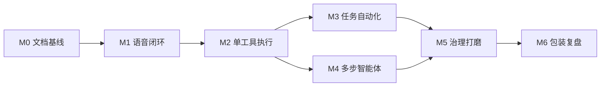

# 05 · 里程碑与拆解

| 字段 | 值 |
| --- | --- |
| 文档 | `docs/05-roadmap.md` |
| 版本 | v0.1.0 |
| 状态 | 草案 |
| 更新 | 2026-10-20 12:12 +08:00 |
| 生效范围 | 阶段划分、验收口径、简历映射 |

---

## 1. 里程碑总览

| 里程碑 | 目标 | 核心交付 | 预估 | 状态 |
| --- | --- | --- | --- | --- |
| **M0** | 工程文档基线 | 规范 + 范围 + 需求 + 架构 + 技术栈 + 拆解 | 1 天 | **进行中（本版）** |
| **M1** | 语音闭环 | PTT → ASR → LLM → TTS，无工具 | 4–5 天 | 未开始 |
| **M2** | 单工具执行 | 开程序 + 一次 HTTP 调用 + 审计 | 4–5 天 | 未开始 |
| **M3** | 任务自动化 | 延时 + cron + 查询 + 持久化恢复 | 3–4 天 | 未开始 |
| **M4** | 多步智能体 | 计划-执行-观察循环 + 进度播报 + 中断 | 6–8 天 | 未开始 |
| **M5** | 治理与打磨 | 风险分级 + 审批 + 托盘 + 时延优化 | 4–5 天 | 未开始 |
| **M6** | 包装与复盘 | 架构图集、指标、技术难点复盘、演示脚本 | 2–3 天 | 未开始 |

**合计约 25–31 个工作日**。按每天 2 小时业余投入算，约 3 个月；全职 5 周。

## 2. 逐阶段拆解

### M0 · 工程文档基线（本次）

| 任务 | 产出 |
| --- | --- |
| 定义文档规范 | `docs/00-spec.md` |
| 划定范围与非目标 | `docs/01-scope.md` |
| 写需求池与验收标准 | `docs/02-requirements.md` |
| 画架构（C4 + 时序 + 状态机 + 类图） | `docs/03-architecture.md` |
| 定技术栈与取舍 | `docs/04-tech-stack.md` |
| 拆里程碑 | `docs/05-roadmap.md` |
| 参考产品对照 | `docs/06-reference-landscape.md` |
| 建 git 与版本基线 | tag `v0.1.0` |

**验收**：任意一个懂技术的人只看 `docs/`，能复述系统有几个组件、主链路怎么走、先做哪一步。

### M1 · 语音闭环（最小可用）

- 音频采集 + VAD + 热键
- ASR 适配器（云）+ TTS 适配器（edge-tts）
- LLM 单轮问答，无工具
- 托盘状态灯：待机 / 聆听 / 思考 / 播报

**验收**：按住热键说"你好，介绍一下你自己"，3 秒内听到回答。
**风险**：音频设备权限、中文断句、TTS 首包延迟。

### M2 · 单工具执行（项目"活"过来的一步）

- Tool Registry + JSON Schema + 风险分级
- 内置工具：`open_app`、`http_get`
- function calling 接入，Decision 分流
- 审计表落库

**验收**：说"打开记事本"与"杭州天气怎么样"，均正确执行并语音回报。

### M3 · 任务自动化

- APScheduler + SQLAlchemyJobStore
- 自然语言 → cron 的解析（先规则，后 LLM）
- 任务查询 / 取消 / 暂停
- 重启恢复与漏跑补偿

**验收**：设定"1 分钟后提醒我喝水"，等待触发；重启进程后任务仍在。

### M4 · 多步智能体

- Planner（任务 → 步骤）
- ReAct 执行循环 + 观察回填
- 步数/时长上限、失败重规划
- 进度播报与语音中断

**验收**：复合任务（如"查三个 AI 会议整理成三条"）能自主完成并汇报。

### M5 · 治理与打磨

- 危险操作二次确认
- 时延埋点与优化（对照架构文档第 6 节预算表）
- 配置界面/文件、密钥管理
- 异常兜底话术

**验收**：端到端 P50 ≤ 2.5s；危险操作拦截率 100%。

### M6 · 包装与复盘

- 架构图集（一页纸版本）
- 关键指标：时延分位、工具成功率、任务完成率
- 技术难点复盘（写清踩坑与取舍）
- 演示脚本（3 分钟讲完三个场景）

**验收**：能在面试中 3 分钟讲清"做什么、怎么做、难在哪、怎么验证"。

## 3. 一张图看依赖

> M3 与 M4 可并行：任务调度与多步执行在代码上解耦，共用工具层。

## 4. 简历映射（提前写好，倒逼实现）

| 里程碑 | 简历可写的一句话 |
| --- | --- |
| M1 | 搭建端到端语音链路，PTT→ASR→LLM→TTS 首音延迟 2.3s |
| M2 | 设计基于 JSON Schema 的工具注册机制，新增能力零改动编排层 |
| M3 | 实现自然语言驱动的定时任务系统，支持 cron/延时/重启恢复 |
| M4 | 实现多步任务规划与 ReAct 执行循环，含步数上限与失败重规划 |
| M5 | 建立工具风险分级与审批机制，全链路审计可回溯 |
| M6 | 输出完整架构文档与决策记录（ADR），关键指标可量化 |

## 5. 下一个动作

M0 收尾只差一件事：**你对 `docs/00-spec.md` 第 11 节三个待定项的确认**。确认后本版即 `v1.0` 冻结，进入 M1。
