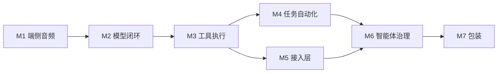

# 05 · 里程碑与拆解

| 字段 | 值 |
| --- | --- |
| 文档 | `docs/05-roadmap.md` |
| 版本 | v0.2.1 |
| 状态 | 草案 |
| 更新 | 2026-11-05 01:40 +08:00 |
| 生效范围 | 阶段划分、验收口径、简历映射 |

---

## 1. 里程碑总览

本地优先把原来的 M1 拆成了两步：**先把耳朵做好（M1），再接上大脑和嘴（M2）**。这样任何一步失败都能定位。

| 里程碑 | 目标 | 核心交付 | 预估 | 状态 |
| --- | --- | --- | --- | --- |
| **M0** | 文档基线 | 规范 + 范围 + 需求 + 架构 + 技术栈 + 模型层 + 拆解 | 1 天 | ✅ v0.2.0 |
| **M1** | 端侧音频前端 | 采集 → 降噪 → VAD → KWS/PTT，可视化调试 | 5–6 天 | 未开始 |
| **M2** | 本地模型闭环 | 本地 ASR + LLM + TTS 全离线跑通 | 6–7 天 | 未开始 |
| **M3** | 工具执行 | 开程序 + HTTP + 审计 + 风险分级 | 4–5 天 | 未开始 |
| **M4** | 任务自动化 | 延时 + cron + 查询 + 重启恢复 | 3–4 天 | 未开始 |
| **M5** | 接入层 | Obsidian 读写检索 + Harness CLI 桥 | 5–6 天 | 未开始 |
| **M6** | 智能体与治理 | 多步任务 + 审批 + 托盘 + 时延优化 | 6–8 天 | 未开始 |
| **M7** | 包装复盘 | 架构图集、指标、演示脚本、复盘 | 2–3 天 | 未开始 |

**合计 32–40 个工作日**。按每天 2 小时业余投入 ≈ 4 个月；全职 ≈ 7 周。

## 2. 逐阶段拆解

### M1 · 端侧音频前端（最容易低估的一步）

| 任务 | 产出 |
| --- | --- |
| `sounddevice` 采集 + 环形缓冲 | 稳定的 16k 单声道流 |
| 降噪 Stage（RNNoise 常开 + DFN3 可选） | A/B 对比脚本与 CER 数据 |
| VAD Stage（Silero） | 端点检测可视化（波形 + 语音概率） |
| PTT 全局热键 | 按下录音、松开断句 |
| 音频回环与延迟测量工具 | 帧级时延日志 |

**验收**：对着麦克风说一句话，终端在 1 秒内打印出正确的断句边界；风扇噪声下不误触发。
**风险**：Windows 音频设备独占、热键与输入法冲突。**先做这个，是因为它决定后面所有体验的上限。**

> **KWS 不在 M1**（2026-11-05 决定）：挪到 M2，与 `12` §3 的 S3 定义对齐——S3 的交付只到"端点"，唤醒是额外一层判定，放进去会让 M1 的验收拖长一倍。M1 只做 PTT。

### M2 · 本地模型闭环

| 任务 | 产出 |
| --- | --- |
| sherpa-onnx + Paraformer 流式 ASR | 首字 ≤ 500ms |
| **KWS（openWakeWord）** | 自训"你好 Vox"模型，唤醒率 ≥ 95%、误唤醒 ≤ 1 次/小时 |
| Ollama + Qwen3-4B | OpenAI 兼容调用跑通 |
| Piper 分句流式 TTS | 首包 ≤ 300ms |
| 三级串联的 asyncio 管线 | 说话→回答全链路 |
| 时延埋点 | 每环节耗时入库 |

**验收**：拔掉网线，说"你好，介绍一下你自己"，3.5 秒内听到回答。
**风险**：CPU 上首 token 慢。缓解见 `03-architecture.md` §6 与 `04-tech-stack.md` §10。

### M3 · 工具执行

| 任务 | 产出 |
| --- | --- |
| Tool Registry + JSON Schema | 注册即生效 |
| `open_app`（白名单 + 别名） | "打开记事本/微信" |
| `http_get`（可选联网） | "查天气" |
| 风险分级 + 审计表 | 每次调用可查 |
| 失败降级话术 | 不抛异常给用户 |

**验收**：`open_app` 与 `http_get` 均成功；断网时 `http_get` 给出合理话术而非报错。

### M4 · 任务自动化

| 任务 | 产出 |
| --- | --- |
| APScheduler + SQLiteJobStore | 任务持久化 |
| 自然语言 → cron（规则优先） | "每天九点" → `0 9 * * *` |
| 查询/取消/暂停 | "我有哪些提醒" |
| 漏跑补偿 | 关机错过的任务启动时补播 |

**验收**：设 1 分钟后提醒；强杀进程重启，任务仍在并触发。

### M5 · 接入层

| 任务 | 产出 |
| --- | --- |
| Obsidian vault 扫描 + 索引 | `note_chunks` 表 |
| ripgrep 全文 + 向量混合检索 | Recall@5 可测 |
| `obsidian://` 打开笔记 | 语音跳转 |
| Harness CLI 桥 | spawn + 事件解析 + 摘要 |
| 摘要播报策略 | 不念代码 |

**验收**：问"我记过的 RAG 笔记说了啥"能给出路径与摘要；一个真实编码任务能委托出去并汇报。

### M6 · 智能体与治理

| 任务 | 产出 |
| --- | --- |
| Planner + ReAct 循环 | 多步任务 |
| 步数/时长上限 | 防死循环 |
| 危险操作二次确认 | 拦截率 100% |
| 托盘 + 配置 | 状态可见 |
| 时延优化 | 对照预算表逐项压 |

**验收**：P50 首音 ≤ 3.0s（CPU）；危险操作全部拦截。

### M7 · 包装

架构图集（一页纸版）、关键指标、技术难点复盘、3 分钟演示脚本。

## 3. 依赖关系

> M4 与 M5 可并行：一个管"时间维度"，一个管"外部世界"，共用工具层。

## 4. 简历映射

| 里程碑 | 简历可写的一句话 |
| --- | --- |
| M1 | 实现端侧音频前端：降噪 + Silero VAD + 自训 KWS，端点延迟 600ms 可调 |
| M2 | 搭建全离线语音链路（Paraformer + Qwen3-4B + Piper），首音 2.8s |
| M3 | 设计 JSON Schema 工具注册机制，支持程序启动与 API 调用，含风险分级 |
| M4 | 实现自然语言驱动的定时任务系统，支持 cron/延时/重启恢复 |
| M5 | 接入 Obsidian 混合检索与外部 agent harness，扩展任务边界 |
| M6 | 多步任务规划 + 审批 + 全链路审计，端到端指标可量化 |

## 5. 下一个动作

M0 收尾只差一件事：**确认 `docs/04-tech-stack.md` 的选型与 `docs/02-requirements.md` 的优先级**。确认后本版升 `v1.0` 冻结，进入 M1。
