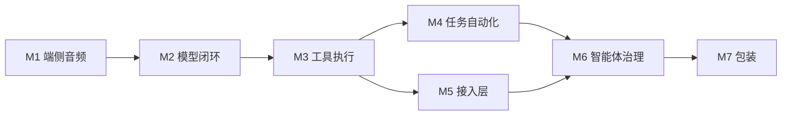

# 07 · 里程碑与拆解

| 字段 | 值 |
| --- | --- |
| 文档 | `docs/07-roadmap.md` |
| 版本 | v0.5.0 |
| 状态 | 已确认（双线基线，2026-11-11 批准；状态列仍随冲刺回写） |
| 更新 | 2026-11-12 00:15 +08:00 |
| 生效范围 | 阶段划分、验收口径、简历映射 |

> **位置**：组 D · **实践 1/4**：按什么顺序推进（状态列会过期）

---

## 1. 里程碑总览

本地优先把原来的 M1 拆成了两步：**先把耳朵做好（M1），再接上大脑和嘴（M2）**。这样任何一步失败都能定位。

| 里程碑 | 目标 | 核心交付 | 预估 | 状态（**回写值**，来源见 §1.1） |
| --- | --- | --- | --- | --- |
| **M0** | 文档基线 | 规范 + 范围 + 需求 + 架构 + 技术栈 + 模型层 + 拆解 | 1 天 | ✅ 2026-10-26（v0.2.0） |
| **M1** | 端侧音频前端 | 采集 → 降噪 → VAD → KWS/PTT，可视化调试 | 5–6 天 | ✅ 2026-11-05（S1–S3，`archive/12-M1process.md`） |
| **M2** | 本地模型闭环 | 本地 ASR + LLM + TTS 全离线跑通 | 6–7 天 | 🟡 **1/4**：S4 ✅ 2026-11-05；S5/S6/S7 ⬜（`08` §2） |
| **M3** | 工具执行 | 开程序 + HTTP + 审计 + 风险分级 | 4–5 天 | ⬜ 未开始 |
| **M4** | 任务自动化 | 延时 + cron + 查询 + 重启恢复 | 3–4 天 | ⬜ 未开始 |
| **M5** | 接入层 | Obsidian 读写检索 + Harness CLI 桥 | 5–6 天 | ⬜ 未开始 |
| **M6** | 智能体与治理 | 多步任务 + 审批 + 托盘 + 时延优化 | 6–8 天 | ⬜ 未开始 |
| **M7** | 包装复盘 | 架构图集、指标、演示脚本、复盘 | 2–3 天 | ⬜ 未开始 |

**合计 32–40 个工作日**。按每天 2 小时业余投入 ≈ 4 个月；全职 ≈ 7 周。

### 1.1 状态列怎么来的（回写协议）

这张表的状态列**不是手工维护的**，它只是两个来源的投影：

| 线 | 状态唯一来源 | 回写时机 |
| --- | --- | --- |
| A 线（M0–M7） | `08-M2process.md` §2 的 S1–S7 表；M1 及以前看 `archive/12-M1process.md` | 某个 S 段的闸门通过时，先改 `08`，再把结果抄进本表 |
| B 线（w 系列） | `09-web-implementation.md` 的验收记录（每版一节） | 每验收一版，先改 `09`，再抄进 §1.2 |

规则三条：

1. **先改冲刺文档，再回写本表**——反过来就是"README 说做完了、冲刺文档没记录"，`AGENTS.md` §8 的门禁会失守；
2. **状态只能由证据升级**：`⬜ → 🟡 → ✅` 必须对应一份带日期的闸门记录，不允许"感觉差不多"；
3. **本表与 `README.md` §3 必须逐行一致**——两边不一致时，以本表为准，并视为 `README` 的缺陷。

### 1.2 B 线（浏览器）阶段

B 线不走 M0–M7，用 `w` 版本推进；它复用 `06` §2.1 的"浏览器"交付形态，不复制 A 线的里程碑。

| 阶段 | 内容 | 状态 |
| --- | --- | --- |
| **w0.1–w0.5** | 脚手架、单轮对话、TTS 播报、多轮上下文、联网工具（细节以代码仓 `CHANGELOG.md` 为准） | ✅ |
| **w0.6** | 浏览器应用：通用/陪伴双模式、F2 按住说话、F3 桌面音频、多轮 `conversation_id`、联网工具带来源、TTS 开关与停止、JSON 会话（30 活跃/100 归档）、`/voice` 声纹页 | ✅ 2026-11-10，验收见 [`09`](09-web-implementation.md) |
| **w0.7（下一个）** | VAD 自动断句（替代按住说话）、流式首字、打断（barge-in）、鉴权与 SSRF 加固、`/api/chat` 与 `store` 单测 | ⬜ |

> B 线的"完成"不等于 A 线的里程碑通过：B 线现在用云端 DeepSeek 推理，**偏离 `ADR-0005` 的本地优先终态**，
> 属于"已知偏离、按期回填"，不算违约（口径见 `01-scope.md` 与 `02` §6）。

## 2. 逐阶段拆解

### M1 · 端侧音频前端（最容易低估的一步）

| 任务 | 产出 |
| --- | --- |
| `sounddevice` 采集 + 环形缓冲 | 稳定的 16k 单声道流 |
| 降噪 Stage（RNNoise 常开 + DFN3 可选） | A/B 对比脚本与 CER 数据 |
| VAD Stage（Silero） | 端点检测可视化（波形 + 语音概率） |
| PTT 全局热键 | 按下录音、松开断句 |
| 音频回环与延迟测量工具 | 帧级时延日志 |

**验收**：对着麦克风说一句话，终端在 1 秒内打印出正确的断句边界；风扇噪声下不误触发。
**风险**：Windows 音频设备独占、热键与输入法冲突。**先做这个，是因为它决定后面所有体验的上限。**

> **KWS 不在 M1**（2026-11-05 决定）：挪到 M2，与 `12` §3 的 S3 定义对齐——S3 的交付只到"端点"，唤醒是额外一层判定，放进去会让 M1 的验收拖长一倍。M1 只做 PTT。

### M2 · 本地模型闭环

| 任务 | 产出 |
| --- | --- |
| sherpa-onnx + Paraformer 流式 ASR | 首字 ≤ 500ms |
| **KWS（openWakeWord）** | 自训"你好 Vox"模型，唤醒率 ≥ 95%、误唤醒 ≤ 1 次/小时 |
| Ollama + Qwen3-4B | OpenAI 兼容调用跑通 |
| Piper 分句流式 TTS | 首包 ≤ 300ms |
| 三级串联的 asyncio 管线 | 说话→回答全链路 |
| 时延埋点 | 每环节耗时入库 |

**验收**：拔掉网线，说"你好，介绍一下你自己"，3.5 秒内听到回答。
**风险**：CPU 上首 token 慢。缓解见 `03-architecture.md` §6 与 `06-tech-stack.md` §10。

### M3 · 工具执行

| 任务 | 产出 |
| --- | --- |
| Tool Registry + JSON Schema | 注册即生效 |
| `open_app`（白名单 + 别名） | "打开记事本/微信" |
| `http_get`（可选联网） | "查天气" |
| 风险分级 + 审计表 | 每次调用可查 |
| 失败降级话术 | 不抛异常给用户 |

**验收**：`open_app` 与 `http_get` 均成功；断网时 `http_get` 给出合理话术而非报错。

### M4 · 任务自动化

| 任务 | 产出 |
| --- | --- |
| APScheduler + SQLiteJobStore | 任务持久化 |
| 自然语言 → cron（规则优先） | "每天九点" → `0 9 * * *` |
| 查询/取消/暂停 | "我有哪些提醒" |
| 漏跑补偿 | 关机错过的任务启动时补播 |

**验收**：设 1 分钟后提醒；强杀进程重启，任务仍在并触发。

### M5 · 接入层

| 任务 | 产出 |
| --- | --- |
| Obsidian vault 扫描 + 索引 | `note_chunks` 表 |
| ripgrep 全文 + 向量混合检索 | Recall@5 可测 |
| `obsidian://` 打开笔记 | 语音跳转 |
| Harness CLI 桥 | spawn + 事件解析 + 摘要 |
| 摘要播报策略 | 不念代码 |

**验收**：问"我记过的 RAG 笔记说了啥"能给出路径与摘要；一个真实编码任务能委托出去并汇报。

### M6 · 智能体与治理

| 任务 | 产出 |
| --- | --- |
| Planner + ReAct 循环 | 多步任务 |
| 步数/时长上限 | 防死循环 |
| 危险操作二次确认 | 拦截率 100% |
| 托盘 + 配置 | 状态可见 |
| 时延优化 | 对照预算表逐项压 |

**验收**：P50 首音 ≤ 3.0s（CPU）；危险操作全部拦截。

### M7 · 包装

架构图集（一页纸版）、关键指标、技术难点复盘、3 分钟演示脚本。

## 3. 依赖关系

> M4 与 M5 可并行：一个管"时间维度"，一个管"外部世界"，共用工具层。

## 4. 简历映射

| 里程碑 | 简历可写的一句话 |
| --- | --- |
| M1 | 实现端侧音频前端：降噪 + Silero VAD + 自训 KWS，端点延迟 600ms 可调 |
| M2 | 搭建全离线语音链路（Paraformer + Qwen3-4B + Piper），首音 2.8s |
| M3 | 设计 JSON Schema 工具注册机制，支持程序启动与 API 调用，含风险分级 |
| M4 | 实现自然语言驱动的定时任务系统，支持 cron/延时/重启恢复 |
| M5 | 接入 Obsidian 混合检索与外部 agent harness，扩展任务边界 |
| M6 | 多步任务规划 + 审批 + 全链路审计，端到端指标可量化 |

## 5. 下一个动作

**双线基线已批准**（2026-11-11，需求方口述）：`A 桌面 / B 浏览器` 两条线并行，共用 `06` 的端侧选型
（ASR / TTS 已一致），差异只在**推理位置**（本地 vs 云端）与**交付形态**（桌面 vs 浏览器）。

每条线同时只允许一个"当前动作"：

| 线 | 当前动作 | 完成判据（闸门） | 其后 |
| --- | --- | --- | --- |
| **A 线** | `08` §2 的 **S5 本地 LLM**（Ollama + Qwen3-4B 接进管线） | 首 token ≤ 1.2s（CPU）；10 条指令里 ≥ 8 条返回合法 JSON（`08` S5 出门闸门） | S6 KWS → S7 串联 |
| **B 线** | **w0.7**：VAD 自动断句 + 流式首字 | 停顿 600ms 自动提交；首字 ≤ 1.2s | 打断 → 鉴权加固 → 单测 |

**仍然悬空的两件**（属于决策，不属于里程碑）：

1. `06` 的 **LLM 运行时**：云端 DeepSeek + 提示词工程，还是本地 Ollama；`06` 状态仍是"部分确认"。
2. `02` 的 **优先级划分**：67 条需求的 P0/P1/P2/P3 是否照此执行；该文件保持「草案」，优先级未确认前不改状态。

> 上一版这里写的是"建议改为双线基线（待需求方批准）"。**已批**，本节据此改成决议，不再列建议。
> 批准不改变 `ADR-0005`：A 线仍以完全离线为终态验收，B 线的云端推理是"已知偏离、按期回填"。
