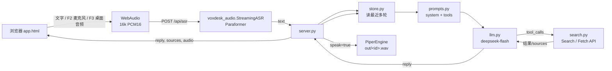

# 架构（当前 Web 版 + 合并后的切片）

> w0.6：把 `D:\VoxDesk` 的 `tts` / `audio` 源码与模型合并进本仓库，
> 在浏览器里完成「语音/文字 → ASR → DeepSeek（联网工具）→ 文字 + Piper 语音」。
> 外部 `D:\VoxDesk` 保持只读。

## 1. 原框架（参考）

原框架是本地优先的桌面语音智能体，5 层 12 组件（`CMP-01`…`CMP-12`）：
端侧语音前端/播报器、会话网关、认知引擎、工具与 Agent、本地推理、Harness 桥、知识接入、
托盘与存储审计。本仓库只取其中最成熟的两块：`CMP-01` 的音频与 `CMP-07` 的播报；
其余组件未实现。

## 2. 合并后的切片

### 2.1 `audio/`（本仓库内，结构不变）

```
audio/src/voxdesk_audio/
├─ capture.py   16k 单声道采集、read_wav、线性重采样
├─ vad.py       Silero VAD（可选）
├─ segmenter.py 端点状态机（本轮未接自动 VAD）
├─ asr.py       StreamingASR（sherpa-onnx Paraformer，16k）
└─ ...
audio/models/sherpa-onnx-streaming-paraformer-bilingual-zh-en/
audio/models/silero_vad.onnx
```

### 2.2 `tts/`（本仓库内，结构不变）

```
tts/src/voxdesk_tts/
├─ engine.py    TTSEngine + PiperEngine
├─ splitter.py  长文本切句
├─ service.py   队列/缓存/打断（本轮只用引擎）
└─ ...
tts/models/zh_CN-huayan-medium.onnx
```

### 2.3 音色分析参考（CosyVoice）

CosyVoice `frontend.py::_extract_spk_embedding`：16k → Kaldi fbank(80, 25ms/10ms) →
帧均值归一化 → CAM++ ONNX → 192 维 speaker embedding。本仓库 `timbre.py` 复刻其
80D log-mel 前端 + 频带统计，映射成 HSL；`/voice` 使用。没有 `campplus.onnx`。

## 3. Web 应用（w0.5）

### 3.1 目录

```
VoxDesk-Web/
├─ server.py       stdlib ThreadingHTTPServer + /api/*
├─ voice_app.py    ASR → 多轮 LLM（工具）→ 可选 TTS
├─ llm.py          deepseek-flash 客户端 + 3 轮工具循环
├─ search.py       DeepSeek Search/Fetch API 执行 + 缓存/cache-bust
├─ store.py        data/chats、data/archive、上限/归档
├─ prompts.py      DSH 风格 system prompt + web_search/web_fetch schema
├─ paths.py        本地模型/数据路径
├─ loopback.py     WASAPI loopback（桌面音频备选）
├─ audio/ tts/     合并后的源码与模型（模型 gitignore）
├─ static/app.html/css/js  通用/陪伴前端（无构建）
├─ static/voice.html       声纹可视化
├─ data/           会话 JSON（gitignore）
└─ docs/
```

### 3.2 数据流



### 3.3 两种模式

- **通用**：侧栏会话、消息流、文字输入、麦克风、桌面音频、朗读/联网开关。
- **陪伴**：同一套存储和接口；文字输入隐藏，只允许语音；回答更短。
- 热键仅页面聚焦时：`F2` 按住麦克风；`F3` 按一下开始、再按一下停止桌面音频
  （浏览器不能注册系统级热键）。

### 3.4 模型与联网

- 生成：`deepseek-flash`（API 版本 **DeepSeek-V4.1-Flash-1017**；`deepseek-v4.1` 不是合法 ID）。
- Chat Completions，`thinking: disabled`，`tools` 传两个函数：
  - `web_search(query)` → `POST /v1/tools/search`
  - `web_fetch(url)` → `POST /v1/tools/fetch`；抓取时追加 `_voxdesk_ts` 防缓存。
- 模型自行决定工具调用；最多 3 轮，之后强制无工具收尾。
- **不注入当前时间**；时间问题必须由模型调用工具（search → 必要时 fetch 实时时钟页）。
- 失败/无结果时如实返回“无法确认”，不伪造。
- 来源 URL 随 assistant 消息保存，前端展示 chips。

### 3.5 本地存储

```
data/chats/<uuid>.json     活跃（≤30）
data/archive/<uuid>.json   归档（≤100）
```

- 单会话文件 ≤1MB；到限制返回 409/413，前端提示归档/删除。
- 活跃满：新建 409；不自动删除活跃。
- 归档满：新归档时自动删最旧归档（按 mtime）。
- 写入 `tmp + os.replace` 原子替换；id 为 uuid hex。
- 只存文本/来源/耗时，不存 wav；朗读按文本重新合成。
- 浏览器只存模式/朗读/联网/最近会话等偏好。

### 3.6 声纹可视化（w0.3/w0.4，保留）

`/voice`：`decodeAudioData` → 1024/4096 点包络 → 希尔伯特曲线（3–6 阶，中心扩展，
振幅 → 线宽/亮度，音色 → HSL），离屏残影层按 `dt` 衰减；规则存 localStorage。
详见 `STATUS.md`。

## 4. 接口契约

| 方法 | 路径 | 请求 | 响应 |
| --- | --- | --- | --- |
| GET | `/` | — | `static/app.html` |
| GET | `/voice` | — | `static/voice.html` |
| GET | `/app.css` `/app.js` | — | 静态资源 |
| POST | `/api/asr` | 16k 单声道 int16 裸 PCM（≤2MB/30s） | `{text, asr_ms, first_char_ms, audio_s}` |
| POST | `/api/chat` | `{conversation_id?, text, mode, speak, web, source?, asr_ms?}` | `{conversation_id, reply, sources, audio, timings, model, tool_rounds}` |
| GET | `/api/chats` | `?archived=0/1` | `{items, stats, limits}` |
| POST | `/api/chats` | `{mode}` | 新建空会话（201） |
| GET | `/api/chats/<id>` | `?archived=1` 可选 | 完整会话 JSON |
| PATCH | `/api/chats/<id>` | `{title}` | 更新后的会话 |
| DELETE | `/api/chats/<id>` | — | `{removed, stats}` |
| POST | `/api/chats/<id>/archive` | — | `{id, purged, stats}` |
| POST | `/api/chats/<id>/restore` | — | `{id, stats}` |
| GET | `/api/health` | — | 模型/ASR/TTS/key/存储状态 |
| GET | `/api/wav/<name>` | — | `audio/wav` |
| GET | `/api/timbre/<name>` | — | 音色 JSON |
| POST | `/api/timbre` | 16k int16 PCM | 音色 JSON |

错误：`{"error": "...", "type": "..."}` + 400/404/409/413/502/500。
`/api/chat` 在 TTS 成功时额外带 `timbre`（给 `/voice` 兼容）。

## 5. 线程模型

`ThreadingHTTPServer` 每请求一线程：

- `PiperEngine` 非线程安全 → `VoiceApp._tts_lock` 串行化 `synth()`；
- `StreamingASR` 用 `_asr_lock` 串行化（保守处理）；
- `ConversationStore` 用 `RLock` 保护目录/元数据；文件原子替换；
- LLM/Search 每请求独立，无共享状态；Search 结果有 5 分钟内存缓存；
- `/api/wav` 仅保留最近 20 个。

## 6. 为什么保留“独立仓库”

原框架有自己的文档、验收和节奏；本仓库继续做快速验证。有效的约定（16k PCM、
ASR 尾静音、TTS 引擎锁、提示词/工具结构）后续可回填原框架，但不在这里修改它。
