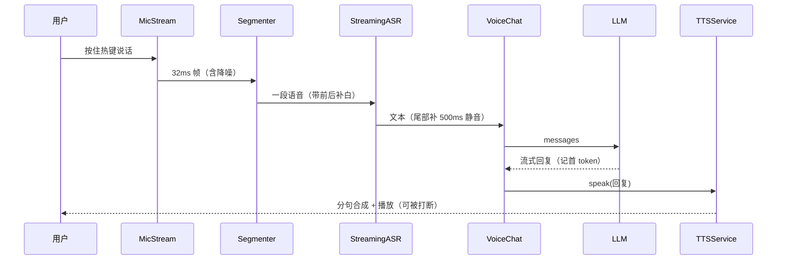

# 实现架构

> 本文描述**代码里实际存在的结构**（v1.0）。设计意图与 C4 图在文档仓 `docs/03-architecture.md`；
> 本文不重复设计理由，只讲"改代码时你要知道的东西"。

## 1. 三个包与职责边界

| 包 | 目录 | 职责 | 对外接口 |
| --- | --- | --- | --- |
| `voxdesk_tts` | `tts/` | 文本 → 音频文件 → 播放；分句、缓存、队列、打断 | `TTSEngine` 协议、`TTSService` |
| `voxdesk_audio` | `audio/` | 采集、降噪、端点检测、按住说话、流式转写 | `MicStream`、`SileroVAD`、`Segmenter`、`StreamingASR` |
| `voxdesk_demo` | `demo/` | 把上面两者拼成一轮对话，接 LLM，打包 | `VoiceChat`、`DeepSeekChat`（仅 demo 分支） |

依赖方向：**demo → tts / audio**，反向不成立。`audio` 与 `tts` 互不依赖，可单独安装使用。

## 2. `tts` 切片

```
src/voxdesk_tts/
├─ engine.py    TTSEngine 协议 + SapiEngine + PiperEngine + make_engine()
├─ sapi.py      Windows SAPI（COM）底层：列音色、朗读、合成到 WAV
├─ player.py    WavPlayer：异步播放 + 每 10ms 轮询停止标志
├─ splitter.py  长文本切句（中英标点、长度上限）
├─ service.py   TTSService：队列、缓存、代次（generation）取消、事件
└─ console.py   Windows 控制台 UTF-8 设置
```

**契约**：

```python
class TTSEngine(Protocol):
    def signature(self) -> str: ...                      # 参与缓存键
    def voices(self) -> list[Any]: ...
    def synth(self, text: str, out_path: Path) -> None: ...  # 只负责落盘，不播放
```

- 引擎只管"文本 → WAV"，**播放与打断归 `TTSService` / `WavPlayer`**。换引擎不改调用方。
- 缓存键 = `sha1(engine.signature() + text)`，不是 `hash(text)`（后者跨进程不稳定）。
- 取消用**代次计数器**：`stop()` 递增代次，旧代次的合成/播放任务自行退出。

## 3. `audio` 切片

```
src/voxdesk_audio/
├─ capture.py    MicStream（回调式采集）、read_wav、resample、iter_frames
├─ vad.py        SileroVAD：ONNX 推理，32ms 帧 → 语音概率
├─ segmenter.py  Segmenter：概率序列 → 语音段（阈值/最短语音/静音尾/前后补白）
├─ denoise.py    SpectralGate + DenoiseStage（可 bypass）
├─ ptt.py        PushToTalk：全局热键按住说话
├─ corpus.py     合成语料与加噪（验收用）
└─ asr.py        StreamingASR：sherpa-onnx 流式识别（transducer / paraformer 自适应）
```

**契约与常量**：

| 项 | 值 | 说明 |
| --- | --- | --- |
| 采样率 / 格式 | 16000 Hz · 单声道 · float32 | 全链路统一，进 ASR 前不再转换 |
| 帧长 | 512 点 = 32ms | VAD 与 Segmenter 都按这个粒度 |
| VAD 阈值 | 0.5 | `Segmenter(threshold=...)` |
| 最短语音 | 250ms | 低于此丢弃 |
| 静音尾 | 600ms | 判定一句话结束；300ms 易切碎，800ms 会粘连 |
| 前后补白 | 100ms | 避免削头尾 |

- `StreamingASR.transcribe(audio)` 返回 `ASRResult(text, audio_s, first_char_ms, total_ms, chunks)`；
  内部会在尾部补 **500ms 静音**，否则最后一个字会被截断。
- 模型目录自动识别：有 `joiner*.onnx` 走 transducer，否则走 paraformer。

## 4. `demo` 切片（仅 demo 分支）

```
src/voxdesk_demo/
├─ llm.py       DeepSeekChat：标准库 urllib + SSE，量首 token；读 .env
├─ app.py       VoiceChat：handle_audio / handle_text → Turn（含分段耗时）
├─ cli.py       命令行：--file / --seconds / 按住 f2(麦克风) / f3(系统声音)
├─ loopback.py  WASAPI loopback 采集（soundcard），与 MicStream 接口一致
└─ paths.py     源码/打包两套路径解析（frozen 时用 exe 旁 models/）
```

`VoiceChat` 是唯一编排点：`transcribe → _ask → _speak`，返回 `Turn` 便于计时与测试。
替换 LLM 只需传入不同对象（`DeepSeekChat` 现在，Ollama 客户端未来）。

## 5. 数据流



## 6. 不变式（改动时别破坏）

1. **半双工**：同一时刻只有"听"或"说"一路；播报期间不采集（demo 用按键天然保证）。
2. **WAV 是边界**：引擎与播放器之间只传文件路径，不传内存 PCM。
3. **引擎不播放**：任何 TTS 引擎实现都不得自己调播放 API。
4. **帧长固定 32ms**：VAD、Segmenter、MicStream 共用 `FRAME_SAMPLES`，改一处要全改。
5. **模型不进仓库**：`models/` 与 `*.onnx` 均在 `.gitignore` 中。
6. **路径不写死**：源码用仓库相对路径，打包后用 `sys.frozen` + exe 同级 `models/`。

## 7. 扩展点

| 想做什么 | 改哪里 | 注意 |
| --- | --- | --- |
| 换 TTS 引擎 | 实现 `TTSEngine` 三个方法，注册进 `make_engine()` | 不改 `service.py`；签名变化会让缓存失效 |
| 换 ASR 模型 | 放进 `audio/models/`，`StreamingASR(model_dir=...)` | 流式模型需带 `joiner*.onnx` 或 paraformer 结构 |
| 接本地 LLM | 写一个 `chat(messages) -> ChatReply` 的对象传入 `VoiceChat` | 现在 `DeepSeekChat` 是唯一实现 |
| 换成免按键 | 用 `SileroVAD + Segmenter` 常开麦，替代 `cli.py` 的按键循环 | 必须处理播报回声（半双工） |
| 加一种输入源 | 实现 `frames(limit)` 生成器，参考 `loopback.py` | 采样率必须是 16k 单声道 |

## 8. 与设计文档的对应

| 设计侧（文档仓） | 实现侧（本仓库） | 状态 |
| --- | --- | --- |
| `CMP-01` 语音前端 | `audio/`（KWS 未做） | 🟡 除唤醒词外已实现 |
| `CMP-07` 播报器 | `tts/` | ✅ 完成 |
| `CMP-02` 会话网关 | 无（demo 用单轮代替） | ⬜ |
| `CMP-03` 认知引擎 | `demo/app.py` 的最小编排 | 🟡 仅一轮 |
| `CMP-04/05/06` 执行与调度 | 无 | ⬜ |
| `CMP-10` 本地推理 | `demo/llm.py`（云端，非本地） | ⬜ 主线待接 Ollama |
