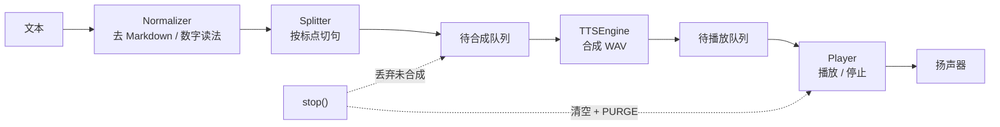

# 09 · TTS 模块（第一个可交付切片）

| 字段 | 值 |
| --- | --- |
| 文档 | `docs/09-tts-module.md` |
| 版本 | v0.4.5 |
| 状态 | 草案 |
| 更新 | 2026-11-05 00:45 +08:00 |
| 生效范围 | 文字转语音模块的语言、分层、接口与实施步骤 |

> 面向"第一次做工程"的读者：每一步都能验证，不要求先懂架构再动手。

---

## 0. 为什么先做 TTS

| 理由 | 说明 |
| --- | --- |
| **失败面最小** | 不依赖麦克风、不依赖模型下载、不依赖网络 |
| **反馈最快** | 十几行代码就能出声，正反馈直接 |
| **它是链路的出口** | 不管 ASR/LLM 怎么错，最后都要"说出去"；先把出口做稳 |
| **能独立演示** | 一个 `speak("你好")` 就是可运行的成果 |

> 一句话：**先让程序会说话，再让它会听话。**

## 1. 语言与工具链

### 1.1 结论

| 项 | 选择 | 理由 |
| --- | --- | --- |
| 语言 | **Python 3.11** | 与主项目一致；TTS 生态以 Python 为一等公民 |
| 包管理 | **uv**（你机器已装 0.13.5） | 能顺带装 Python 解释器，省掉手动安装与环境变量 |
| 起步引擎 | **Windows SAPI**（系统自带） | 零下载、零模型、零 GPU |
| 上线引擎 | **piper1-gpl**（GPL-3.0） | 首包延迟最低、直接吐 WAV；与 `08` §5 的 M2 选择一致 |
| 备选引擎 | **sherpa-onnx TTS**（Apache-2.0） | 不新增依赖（ASR 已用它）；中文质量略低于 Piper |
| 音质上限 | **CosyVoice**（Apache-2.0） | 中文最佳，但 0.5B + 流式接口，留到 M6 |

### 1.2 你的机器现状（2026-11-04 实测，替换 10-28 快照）

| 项 | 状态 |
| --- | --- |
| `uv` | ✅ 0.13.5 |
| `python` | ✅ 3.11.17（`uv python install 3.11`，装在 `D:\uv-python\cpython-3.11-windows-x86_64-none`） |
| SAPI 5 音色 | ✅ 3 个：`Microsoft Huihui Desktop`（zh-CN）、`Zira`、`David`（en-US） |
| OneCore 音色 | ⚠️ 另有 6 个（含 Kangkang、Yaoyao、Huihui）注册在 `Speech_OneCore`，**64 位 SAPI 5 的 `SpVoice` 看不见** |
| 音频输出 | ✅ Realtek + USB Audio Device |
| 合成性能 | ✅ 22.05 kHz / 16 bit / 单声道；5.8 s 音频合成耗时 0.05 s（实时因子 0.009） |

**修正 10-28 的记录**：当时写的"Huihui、Kangkang、Yaoyao 可用"只对 PowerShell 的 `System.Speech` 成立（它把 OneCore 音色也列出来了），**Python 侧只能拿到 `Huihui Desktop` 一个中文音色**。想要男声或更多中文音色，要么另装 SAPI 5 语音包，要么等 S2 的 Piper（`zh_CN-huayan`）。

**结论**：解释器与音色已就位，S0 不需要任何模型文件。

## 2. 三阶段路线

| 阶段 | 目标 | 技术 | 工期 | 验收 |
| --- | --- | --- | --- | --- |
| **A 出声** | 听到中文语音 | `pywin32` + SAPI | 0.5 天 | 控制台跑一条命令能听到"你好" |
| **B 架构** | 长文本边合成边播、可打断 | 分句 + 线程队列 + `winsound` | 2–3 天 | 500 字文本首声 < 1.5s；`stop()` 300ms 内静音 |
| **C 换引擎** | 断网可用、验证可替换性 | **`piper1-gpl`** | 2–3 天 | 拔网线仍能播；调用方代码零改动；音质明显优于 SAPI |

**关键**：B 阶段把架子搭对，C 阶段只换一个类。**顺序不能反**——先接引擎再补架构，代码会粘成一团。

## 3. 架构



### 3.1 四个部件，各管一件事

| 部件 | 职责 | 为什么单独拆 |
| --- | --- | --- |
| **Normalizer** | 清理输入：去掉 `**`、代码块、URL；把"3:5"读成"三比五" | 模型读错符号是常见问题，清洗比调模型便宜 |
| **Splitter** | 按 `。！？；` 切句，每段 ≤ 50 字 | **首音延迟的关键**：整段合成要等全文，切句后可边合成边播 |
| **TTSEngine** | 文本 → WAV 文件 | 唯一与"引擎"耦合的地方；换引擎只改这里 |
| **Player** | 播放 WAV、支持停止 | 播放与合成解耦，才能"合成下一句时播上一句" |

### 3.2 核心设计：以 WAV 为界

```
TTSEngine 只负责把文本变成 WAV 文件
Player    只负责把 WAV 文件播出去
```

这条缝是整个模块最重要的设计。因为所有引擎都能输出 WAV：

| 引擎 | 输出 | 接入成本 | 用在 |
| --- | --- | --- | --- |
| SAPI | `SpFileStream` 写 WAV | 极低 | 阶段 A/B |
| piper1-gpl | 直接吐 WAV | 极低 | 阶段 C |
| sherpa-onnx TTS | 自带 `wave` 写出 | 低 | 备选（不新增依赖） |
| CosyVoice | **流式 PCM** | 高 | M6（需扩展接口，见 §3.3） |

所以"换引擎"= 换一个实现了 `TTSEngine` 的类，`Player` 一行不改。

### 3.3 已知边界：这个契约装不下流式引擎

`08` 的数据显示 CosyVoice3 支持**双向流式、延迟 150ms**。而本模块的契约是 `synth(text, out_path)`——**先把整句写完文件，再播放**。两者的差别在：

| 维度 | 文件契约（本模块） | 流式契约 |
| --- | --- | --- |
| 首包 | 等整句合成完 | 边合成边播 |
| 长句 | 句内仍需等待 | 句内可提前出声 |
| 实现复杂度 | 低（可缓存、好测） | 高（背压、断流、对齐） |

**结论**：M0.5–M2 用文件契约是对的；**M6 接 CosyVoice 时必须扩展 `synth_chunks(text) -> Iterator[bytes]`**，`Player` 增加 `play_stream()`。这不是返工，是分阶段——但要现在记下来，否则到 M6 才发现接口挡住了路。

## 4. 接口契约

```python
# engine.py
from pathlib import Path
from typing import Protocol

class VoiceInfo(Protocol):
    id: str
    name: str
    locale: str

class TTSEngine(Protocol):
    def voices(self) -> list[VoiceInfo]: ...
    def synth(self, text: str, out_path: Path) -> None:
        """把 text 合成为 WAV 文件；阻塞直到写完。"""
```

```python
# player.py
class Player(Protocol):
    def play(self, wav_path: Path) -> None:
        """同步播放，直到播完或被 stop() 打断。"""
    def stop(self) -> None:
        """立即静音并丢弃当前播放。"""
```

```python
# service.py —— 对外只用这两个方法
class TTSService:
    def speak(self, text: str) -> None: ...
    def stop(self) -> None: ...
```

> 记住这三个方法就够了：`speak()` / `stop()` / `voices()`。

## 5. 目录结构

```
tts-demo/
├── pyproject.toml          uv 生成
├── .python-version         3.11
├── ttsdemo/
│   ├── __init__.py
│   ├── splitter.py         切句（纯函数，最好测）
│   ├── engine.py           TTSEngine 协议 + SapiEngine
│   ├── player.py           WavPlayer（winsound）
│   ├── service.py          串起来 + 队列 + 停止
│   └── cli.py              命令行入口
├── cache/                  合成结果缓存（git 忽略）
└── tests/
    └── test_splitter.py    先测切句，不用麦克风也不用扬声器
```

## 6. 第一天：从零到出声

### 6.1 五条命令

```powershell
uv python install 3.11
uv init tts-demo
cd tts-demo
uv add pywin32
uv run python -c "import win32com.client; print('ok')"
```

> `uv init` 会自动建 `.venv`，`uv add` 装依赖，`uv run` 在虚拟环境里执行——**不需要手动激活环境**，这是 uv 相比 pip 最省心的地方。

### 6.2 探测可用音色

```python
# probe.py
import win32com.client

sp = win32com.client.Dispatch("SAPI.SpVoice")
voices = sp.GetVoices()
for i in range(voices.Count):
    print(f"[{i}] {voices.Item(i).GetDescription()}")
```

```powershell
uv run python probe.py
```

预期能看到 `Microsoft Huihui Desktop`、`Microsoft Kangkang`、`Microsoft Yaoyao`。

### 6.3 让它说话

```python
# speak.py
import win32com.client

TEXT = "你好，我是 VoxDesk。这是一段中文语音测试。"

sp = win32com.client.Dispatch("SAPI.SpVoice")

# 选中文音色
voices = sp.GetVoices()
for i in range(voices.Count):
    if "Huihui" in voices.Item(i).GetDescription():
        sp.Voice = voices.Item(i)
        break

sp.Rate = 0        # -10 很慢 ~ 10 很快，0 是正常
sp.Volume = 100    # 0 ~ 100
sp.Speak(TEXT)     # 同步阻塞，说完才返回
```

```powershell
uv run python speak.py
```

**听到声音 = 阶段 A 完成。** 这一步没有任何"工程"含量，但它验证了三件事：解释器能跑、COM 能调、音响能响。

### 6.4 合成到文件（进入阶段 B 的钥匙）

```python
# to_wav.py
import win32com.client
from pathlib import Path

def synth_to_wav(text: str, out: Path) -> None:
    sp = win32com.client.Dispatch("SAPI.SpVoice")
    stream = win32com.client.Dispatch("SAPI.SpFileStream")
    stream.Open(str(out), 3)          # 3 = SSFMCreateForWrite
    sp.AudioOutputStream = stream
    sp.Speak(text)
    stream.Close()

synth_to_wav("第一句。第二句。", Path("demo.wav"))
print("written")
```

> 注意 `stream.Open` 的第二个参数是**格式枚举**，不是文件模式字符串。这是 SAPI 最容易被写错的地方。

## 7. 阶段 B：骨架代码

下面是最小可用骨架，能跑，但**故意省略了异常处理**（留给阶段 B 补齐）。

```python
# splitter.py
import re

_PUNCT = re.compile(r'(?<=[。！？；!?;])')

def split(text: str, max_len: int = 50) -> list[str]:
    """按标点切句，并合并过短的句子。"""
    raw = [s.strip() for s in _PUNCT.split(text) if s.strip()]
    out, buf = [], ""
    for s in raw:
        if len(buf) + len(s) <= max_len:
            buf += s
        else:
            if buf:
                out.append(buf)
            buf = s
    if buf:
        out.append(buf)
    return out
```

```python
# service.py
import queue, threading, winsound
from pathlib import Path
from splitter import split

class TTSService:
    def __init__(self, synth, cache_dir: Path = Path("cache")):
        self.synth = synth
        self.cache = cache_dir
        self.cache.mkdir(exist_ok=True)
        self.q: queue.Queue[str | None] = queue.Queue(maxsize=8)
        self.stop_flag = threading.Event()
        threading.Thread(target=self._worker, daemon=True).start()

    def _worker(self):
        while True:
            seg = self.q.get()
            if seg is None:
                return
            if self.stop_flag.is_set():
                continue
            wav = self.cache / f"{abs(hash(seg))}.wav"
            if not wav.exists():
                self.synth(seg, wav)
            if self.stop_flag.is_set():
                continue
            winsound.PlaySound(str(wav), winsound.SND_FILENAME)  # 同步

    def speak(self, text: str):
        self.stop_flag.clear()
        for seg in split(text):
            self.q.put(seg)

    def stop(self):
        self.stop_flag.set()
        winsound.PlaySound(None, winsound.SND_PURGE)   # 打断
        while not self.q.empty():                      # 丢弃未合成
            try:
                self.q.get_nowait()
            except queue.Empty:
                break
```

三个要点：

1. **合成线程**与调用方解耦——`speak()` 立刻返回，不阻塞
2. `winsound.SND_PURGE` 是 Windows 自带的"立即静音"，**不需要额外库**
3. `hash(seg)` 做缓存键：同一句话第二次播报不再合成

> **⚠️ 2026-11-04 实测修正**（S1 落地时发现，两条都不成立）
>
> **(1) 同步播放 + 另线程 `SND_PURGE` 打不断。**
> 实测：4.40 s 音频，播到 0.5 s 时从主线程调 `PlaySound(None, SND_PURGE)`，
> 同步调用的阻塞时长仍是 **4.55 s**——一点没停。
> 原因：`SND_PURGE` 只停**调用线程自己**的发声；同步播放把线程阻塞在播放里，
> 别的线程够不着它。
> 落地做法：**异步播放（`SND_ASYNC`）+ 10 ms 轮询取消标志**，在播放线程内 purge，
> 实测静音 **38.8 ms**（见 `D:\VoxDesk\tts` v0.2.0 的 `player.py`）。
>
> **(2) 不能用 `hash(seg)` 当缓存键。**
> Python 的 `hash` 每个进程随机（`PYTHONHASHSEED`），重启即失效；
> 且键里不含音色 / 语速，换音色会读到旧音频。
> 改用 `sha1(engine.signature + text)[:16]`，`signature` 里带上引擎名、音色、语速。

## 8. 验收标准

| 阶段 | 可测项 | 通过标准 |
| --- | --- | --- |
| A | 出声 | 跑命令能听到中文 |
| B-1 | 分句 | 500 字文本切出的段落 ≤ 50 字，且不切断完整句子 |
| B-2 | 首音 | 点击到第一声 ≤ 1.5s |
| B-3 | 打断 | 播报中 `stop()`，300ms 内静音 |
| B-4 | 缓存 | 同一句第二次播放不再触发合成 |
| C-1 | 离线 | 断网后仍能播报 |
| C-2 | 可替换 | 换引擎不改 `service.py` |

**实测（S1 2026-11-04 / S2 2026-11-05，`D:\VoxDesk\tts` v0.3.0）**

| 项 | 判据 | SAPI（S1） | Piper（S2） | 结论 |
| --- | --- | --- | --- | --- |
| B-1 分句 | 500 字 → 每段 ≤ 50，不切整句 | 445 字 → **10 段**，最长 46，无内容丢失 | 同左（纯函数） | ✅ |
| B-2 首音 | ≤ 1.5 s | 冷启动中位 **91 ms** | **56 ms**（10 字）/ 169 ms（34 字） | ✅ |
| B-3 打断 | ≤ 300 ms | **38.8 ms** | **12.2 ms** | ✅ |
| B-4 缓存 | 二次不触发合成 | 合成 0 段、命中 1 段 | 同左 | ✅ |
| C-1 离线 | 断网仍能播 | —— | 三个代理变量指向死端口，仍合成 0.099 s / 2.62 s 音频 | ✅ |
| C-2 可替换 | 换引擎不改 `service.py` | —— | `git diff` 显示 `service.py` **零改动** | ✅ |

> **S2 的真正交付物不是 Piper，是这张表的最后一行。** Piper 只是用来证明"可替换"的工具人；
> 它跑通了，说明 M6 换 CosyVoice 时不需要动编排层（见 §11）。

## 9. 常见坑（按踩到的概率排序）

| # | 现象 | 原因 | 解法 |
| --- | --- | --- | --- |
| 1 | `python` 不是内部或外部命令 | 没装 Python | `uv python install 3.11`，用 `uv run` 执行 |
| 2 | 控制台中文乱码 | 终端编码是 GBK | `$env:PYTHONUTF8=1`，或 `chcp 65001` |
| 3 | `ImportError: No module named win32com` | pywin32 装了但 COM 未注册 | 跑 `.venv\Scripts\python.exe -m pywin32_postinstall -install` |
| 4 | `Speak()` 卡住不动 | 默认同步阻塞 | 属正常；要异步用 `sp.Speak(text, 1)`（1=异步） |
| 5 | 播报没有声音但没报错 | 输出设备不是默认设备 | 控制面板 → 声音 → 设默认播放设备 |
| 6 | 长文本一次性合成很慢 | 整段合成才出声 | 必须分句（见 `splitter.py`） |
| 7 | `winsound` 报"无法播放" | 文件不是 PCM WAV | SAPI 直接写出的就是 PCM，别用 MP3 转 |
| 8 | 中文语音列表里没有 Huihui | 系统是英文版 | 设置 → 时间和语言 → 语音 → 添加中文语音包 |

## 10. 与主项目的关系

| 本文档 | 主项目 |
| --- | --- |
| `TTSService.speak()` | `IF-05 Speak(text_stream) -> PlaybackHandle` |
| `TTSEngine` | `CMP-07 播报器` 的引擎适配层 |
| `Player.stop()` | `REQ-F-003` 热键打断 |
| 缓存目录 | 可并入 `CMP-09` 的存储策略 |
| M6 换 CosyVoice | `06-tech-stack.md` 的音质目标；需先按 §3.3 扩展流式接口 |
| **已实现的 C4 图** | 在代码仓 `tts/README.md` 维护：`CTX-07` 上下文、`C4-07` 容器、`C3-07` 组件。**规则：图里出现 = 代码里存在**，计划项只进"未实现"表 |

**与路线图的关系**：把 `M2` 里的 TTS 部分提前，作为"技术栈可行性的最小切片"。做完这个模块，`06-tech-stack.md` 的 TTS 选型就从"纸面推荐"变成"亲手验证"。

> 这也是给面试准备的最好素材：**"我先做了一个能出声的最小模块，验证了窗口/音频/许可三件事，再决定整体架构。"**

## 11. 迁移到 CosyVoice：设计（GPU 8 GB，2026-11-05）

**状态**：只设计、不实现。触发条件是 M6；S2 已经证明"换引擎不动编排层"，所以这里只回答"怎么接"。

### 11.1 前提

| 项 | 值 |
| --- | --- |
| GPU | `RTX 4060 Laptop · 8 GB 显存`（2026-11-05 实测） |
| 内存 | 16 GB |
| 模型 | `Fun-CosyVoice3-0.5B` 或 `CosyVoice2-0.5B`（Apache-2.0） |
| 依赖 | torch + torchaudio + 其仓库 requirements（**约 2.5–3 GB**） |

### 11.2 三种接法

| 方案 | 做法 | 优点 | 缺点 | 结论 |
| --- | --- | --- | --- | --- |
| **A 进程内** | 直接 `import cosyvoice`，写 `CosyVoiceEngine` | 零 IPC 开销 | torch 2.5 GB 进同一个 venv；显存与 LLM 抢；启动 10 s+ | ❌ |
| **B 独立服务** | 单独 venv + FastAPI/gRPC 起在 `localhost`；`CosyVoiceEngine` 走 HTTP | 依赖隔离、可单独重启、可共享给其它组件 | 多一个进程，每段 5–20 ms 往返 | ✅ **推荐** |
| **C CLI 子进程** | 每句起一个 python 脚本 | 最简单 | 模型加载 5–10 s/次，不可接受 | ❌ |

B 与 `06` §4 "ASR/TTS 不走 HTTP"不矛盾：那条针对**流式小包**；CosyVoice 是 LLM-TTS，一次请求天然较长，HTTP 开销可忽略。

### 11.3 接口缺口（现在记下来，M6 补齐）

| 现状 | CosyVoice | 迁移动作 |
| --- | --- | --- |
| `synth(text, out_path)` → 文件 | `stream=True` 时返回生成器，边生成边出 | 加 `synth_chunks(text) -> Iterator[bytes]` |
| `Player.play(wav_path)` | 边生成边播 | 加 `Player.play_stream(chunks)` |
| 缓存键是 `sha1(signature+text)` → wav 路径 | 流式没有整段文件 | 改成"首段落盘 + 后续直通"，或 M6 干脆不做缓存 |

### 11.4 验收判据（M6）

| 项 | 判据 | 依据 |
| --- | --- | --- |
| 首包 | ≤ 400 ms | 150 ms 是服务器 GPU 的数；4060 Laptop 按 2–3 倍折算 |
| RTF | ≤ 0.3 | 现在 Piper 是 **0.026**；换引擎可以慢一个数量级，不能再多 |
| 峰值显存 | ≤ 6 GB | 8 GB 要留 2 GB 给 Qwen3-4B 与系统 |
| 音质 | A/B 盲听优于 Piper（≥ 3 人） | 换它的**唯一**理由 |
| 回退 | `make_engine("piper")` 一条命令切回 | S2 已保证 |

### 11.5 风险

| 风险 | 说明 | 缓解 |
| --- | --- | --- |
| 仓库 5 个月未提交 | 2026-05-25 之后无 push | 按"当前版本可用"评估，不指望它修 bug |
| 8 GB 显存不够同时跑 | Qwen3-4B ≈ 3 GB + CosyVoice ≈ 2–3 GB + 系统 | 先串行：播报时卸载 LLM；或 LLM 降 Q4 |
| Python 3.11 + torch 版本冲突 | 其 requirements 与现有 venv 不同 | 独立 venv（方案 B 天然隔离） |

### 11.6 第一步（半天，不写进本仓）

1. `git clone` CosyVoice 到 `D:\VoxDesk\vendor\`（gitignore）；
2. 独立 venv 装依赖，跑 `python webui.py`；
3. 合成一句中文，**只听、只量 RTF 与首包**；
4. 达标再谈写 `CosyVoiceEngine`；不达标就把它留在 `08` §3.3 的"什么情况下会变成正确答案"里。

> 这一步的产出应该是一张数字表，不是代码。
