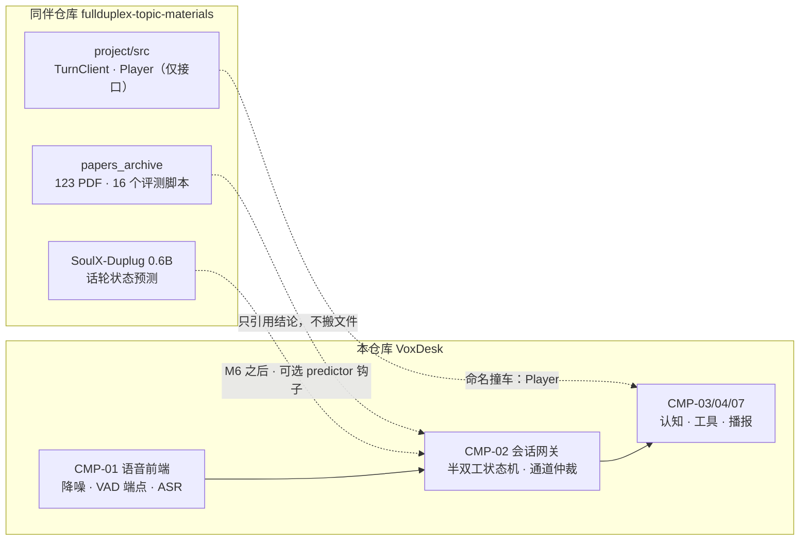

# 11 · 同伴仓库核查（fullduplex-topic-materials）

| 字段 | 值 |
| --- | --- |
| 文档 | `docs/11-peer-repo-crosscheck.md` |
| 版本 | v0.1.2 |
| 状态 | 草案 |
| 更新 | 2026-11-11 21:50 +08:00 |
| 生效范围 | 与同伴仓库 `white-polaris/fullduplex-topic-materials` 的口径核对结论；**不改变**本仓库既定架构 |

> 本文只回答一个问题：**对方的框架、技术栈、工程形态，与我方基线哪些地方对不上，谁该改。**
> 结论先行：**大部分分歧不是谁写错了，而是两个仓库在交付不同的东西**；真正必须先决策的只有 3 条。

---

## 0. 证据边界（先说清楚什么没看）

核查对象：`D:\GitHub\fullduplex-topic-materials`（fork 自 `white-polaris/fullduplex-topic-materials`）。

| 证据 | 来源 | 可支撑的结论强度 |
| --- | --- | --- |
| 7 份 README 的**结论摘要** | 需求方口头转述（根目录 1 + `project/` 下 6） | 只能核对"它声称什么"，不能核对它论证得对不对 |
| 一级/二级目录清单、文件计数、体积 | 本机实测（命令见 §7） | **强**：结构级事实 |
| `project/scripts/check_env.sh` 全文（74 行） | 本机读取（唯一打开的非 Markdown 文本） | **强**：环境门槛写在代码里 |
| git 元数据（分支、远端、日志、LFS、工作区状态） | 本机实测 | **强** |

**没读**：`project/docs/` 的 14 篇正文、`全双工交互_资料汇编.md`（174 KB）、`papers_archive/` 的 123 篇 PDF、根目录 `.docx`。
因此下文凡涉及"对方内容观点"的，一律标注**（摘要转述）**，只转述、不背书。

## 1. 一句话结论

> 对方是**"课题弹药库 + 刚起步的课程工程"**，我方是**"简历项目的架构基线"**。两者共享同一个课题背景（全双工误停顿/误响应/误打断/响应慢），但不是同一交付物。

由此推出三条判断：

1. **A 级冲突（3 条）必须现在决策**——它们决定"能不能共用一台机器、一套代码"；
2. **B 级摩擦（3 条）可以在真要对接时再处理**，但要先记下接口撞车点；
3. **C 级瑕疵（6 条）只影响引用可信度**，不影响架构——但引用对方任何数字前必须重测。

## 2. 不一致清单

分级口径：

| 级别 | 含义 | 处理时限 |
| --- | --- | --- |
| **A** | 会导致返工、或两边无法在同一环境下运行 | 开工前必须决策 |
| **B** | 会造成重复劳动、集成摩擦、命名冲突 | 对接时处理，先记录 |
| **C** | 事实/文书瑕疵 | 引用前重测即可 |

### 2.1 A 级：会互相伤害的三条

| # | 维度 | 对方口径（证据） | 我方基线（引用） | 判定 |
| --- | --- | --- | --- | --- |
| **A1** | **交互形态** | 全双工：`project/docs` 规划"话轮状态预测器"，插在 LLM 与 TTS 之前，解决误停顿/误响应/误打断（摘要转述）；根目录 `.docx` 标题即"全双工…" | **半双工先行**，全双工列 P3；见 [`01-scope.md`](../01-scope.md) §5、[`REQ-F-013`](../02-requirements.md)（P3 降级）、[`REQ-C-007`](../02-requirements.md)、`ADR-0006`、[`03-architecture.md`](../03-architecture.md) §7 | **有意的分歧，不是错误**。但若不声明，答辩时会被问"你的项目和课题什么关系" |
| **A2** | **推理硬件** | `check_env.sh` 第 36 行：CUDA 不可用即 `[FAIL]`，"状态服务默认 `device=cuda`，跑不了"；第 33–34 行：显存 < 22 GiB 警告"完整对话系统可能放不下" | 8 GB 最低档 / 16 GB 推荐档，纯 CPU 跑 4B；见 [`06-tech-stack.md`](../06-tech-stack.md) §9、[`REQ-N-002`](../02-requirements.md) | **硬冲突**：同一台机器不可能同时满足"≥22 GB 显存"与"8 GB 内存可跑" |
| **A3** | **是否训练模型** | 基于 SoulX-Duplug 0.6B 训练话轮状态预测器（摘要转述）；`check_env.sh` 第 63 行预期 `pretrained_models`/`third_party/SoulX-Duplug` 存在 | **训练/微调明确列为非目标**；见 [`01-scope.md`](../01-scope.md) §5、[`06-tech-stack.md`](../06-tech-stack.md) §8 | **范围冲突**：我方交付的是编排层，不是模型 |

**A 级的共同根因**：课题验收看"三个指标"（尾点准确率 >90% 且时延 <300 ms；拒识 误拒<2% / 拒识率>90%；打断 误拒<2% / 拒识率>85%，见根目录提案 `基于全双工语音交互大模型…md`（作者私有笔记，不在本仓）），而我方验收看**五条可现场演示的行为**（[`01-scope.md`](../01-scope.md) §7）。**指标型交付与演示型交付，本来就不该共用一套代码。**

### 2.2 B 级：会造成重复劳动

| # | 维度 | 对方口径（证据） | 我方基线（引用） | 判定与处置 |
| --- | --- | --- | --- | --- |
| **B1** | **语言与运行时** | bash 脚本、`python3`、官方要求 **3.10**、`torch` + CUDA、结尾提示"可以跑 `run.sh`"（`check_env.sh` 第 11/21/24/74 行） | **Windows 11 + PowerShell**（[`REQ-C-005`](../02-requirements.md)）；**Python 3.11 + uv**（[`06-tech-stack.md`](../06-tech-stack.md) §1.4） | 3.10 与 3.11 可共存，**但脚本不可复用**。我方环境检查自己写 `.ps1`，不抄 `check_env.sh` |
| **B2** | **接口命名** | `project/src/README.md` 定义 `TurnClient`、`Player`（摘要转述，代码未落地） | `IF-05 Speak(text_stream) -> PlaybackHandle`；`Player.play(wav_path)`（[`09-tts-module.md`](09-tts-module.md) §4） | **`Player` 撞名**。若将来对接：我方内部保留 `Player`，对外只认 `IF-05`；不承诺对方脚本可直接调用我方类 |
| **B3** | **预测器插点** | "插在 LLM 和 TTS 前面"（摘要转述） | 对应的位置是 **CMP-02 会话网关**（状态机 + 通道仲裁）与 **CMP-01 端点判定** | 缺一层映射声明。**建议落点**：CMP-02 内部加 `predictor` 钩子，而不是"LLM 之前"——见 §4 |

### 2.3 C 级：事实性瑕疵（只影响引用可信度）

| # | 对方说法 | 实测（2026-10-29 15:12） | 备注 |
| --- | --- | --- | --- |
| **C1** | README 称 **124 篇**论文 | `papers_archive/` 根层 **123** 个 PDF，递归仍 **123** | 差 1 篇。可能是删过、或把子目录算进去 |
| **C2** | 资料层"约 **171 MB**" | `papers_archive` **213.0 MB**；`.git` **167.2 MB**；全仓 **381.9 MB**；`project` 0.2 MB | 171 对不上任何一项，疑为早期快照 |
| **C3** | 50 个 txt、24 个 html | 实测 **82** 个 txt、**47** 个 html（不含 `_html_snapshots/` 的 52 个） | 统计口径未写清 |
| **C4** | 当前"第 2 周" | `project/docs/04_周计划.md`、`meetings/2026-10-23_第1周.md` 仍是第 1 周；最后提交 **2026-10-28** | 计划未刷新，非事实错误 |
| **C5** | `project/README.md` 自称 `ansz395/duplex-voice-agent` 个人备份 | 工作区 `origin` = `white-polaris/fullduplex-topic-materials` | **双仓库视角**，协作说明可能指错库 |
| **C6** | `check_env.sh` 第 74 行"可以跑 `run.sh`" | 全仓 **0 个 `run.sh`**；`project/` 内唯一代码文件是 `scripts/push_via_api.py`（推送工具，非项目代码）；`src`、`data`、`models`、`third_party` **四个目录只有 README** | 典型"文档先行、代码未落地" |

> 另外：工作区**不干净**——`.obsidian/` 的 4 个配置文件处于已 `A` 暂存、未提交状态；仓库**未配置 LFS**（无 `.gitattributes`），213 MB 二进制已进 git 历史。

## 3. 技术栈逐项对照

| 维度 | 同伴（实测 + 摘要） | 我方（`docs/04`） | 关系 |
| --- | --- | --- | --- |
| 交付物 | 课题资料库 + 课程工程（四人分工） | 简历项目（单人、可演示） | **不同** |
| 交互形态 | 全双工 | 半双工（全双工 P3） | **冲突（A1）** |
| 主语言 | Python（3.10） | Python（3.11） | 兼容，脚本不通用（B1） |
| 包管理 | 未声明（`check_env.sh` 用 `python3` + `pip` 风格） | `uv` | 我方更严 |
| 推理后端 | **PyTorch + CUDA，默认 GPU** | **onnxruntime + Ollama，CPU 优先** | **冲突（A2）** |
| 硬件门槛 | NVIDIA GPU；<22 GiB 显存即降级警告 | 8/16 GB 内存，无 GPU 亦可 | **冲突（A2）** |
| 核心模型 | SoulX-Duplug 0.6B（话轮状态预测） | Qwen3-4B/8B（认知）+ Paraformer（ASR）+ Piper（TTS） | **互补而非替代** |
| 语音管线 | 未落地（仅接口约定） | 自研 asyncio Frame/Stage（`ADR-0007`） | 无冲突 |
| 端点判定 | 交给训练出的预测器 | Silero VAD 端点（600 ms 可调） | 方法论不同 |
| 调度 / 存储 | 未涉及 | APScheduler + SQLite（`ADR-0003`） | 无冲突 |
| 前端 | 无（仓库用 Obsidian 管理） | 托盘 `pystray` | 无冲突 |
| 部署 | bash + `run.sh`（不存在） | PowerShell + `uv run` | 无冲突 |
| 验收 | 三个量化指标（课题口径） | 五条演示行为（`01-scope.md` §7） | **不同（A1 的表征）** |

## 4. 若将来对接：唯一合法接缝

| 对方概念 | 我方落点 | 现状 | 前置条件 |
| --- | --- | --- | --- |
| `TurnClient`（话轮状态预测） | `CMP-02` 内新增 `predictor` 钩子 | 未实现 | 需常开麦克风 → 属 P3（`REQ-F-013`） |
| `Player` | `CMP-07` 播报器 / `IF-05` | 我方已有同名接口 | 对方需改名或加命名空间 |
| SoulX-Duplug 0.6B | 模型层"可选组件"，与 Qwen3 并列但**不进 P0** | 未接入 | 需 ≥22 GB 显存，与 `REQ-N-002` 冲突 |
| `papers_archive` + 评测脚本 | 仅作调研引用，**不入本仓库** | 已读结论摘要 | 引用前必须重测数字（C1–C3） |

**三条硬约束**（写给未来的自己）：

1. **不合并代码库**——两边的验收方式根本不同，合并只会让"可演示"变成"可解释"；
2. **不共用 venv**——`torch`+CUDA 与 `onnxruntime`+Ollama 的依赖树会互相污染；
3. **不搬运 213 MB 论文**——本仓库保持纯文本，引用用路径 + 标题，不复制 PDF。

## 5. 答辩口径（三句话，背下来）

| 会被问到 | 回答 |
| --- | --- |
| **为什么不做全双工？** | 全双工要同时解决 AEC、常开麦克风、双工状态机三件事，是独立量级；先做半双工能把"听清→听懂→办成"跑通，架构已留 `AECStage` 与 `BargedIn` 两个接入点（`03-architecture.md` §7） |
| **和这个课题什么关系？** | 借的是**问题定义**（误停顿/误响应/误打断/响应慢），不是**交付形态**；课题要训预测器，我交付可用系统 |
| **为什么不用 SoulX-Duplug 0.6B？** | 它解决的是"这句话该不该接"，而半双工下播报时麦克风关闭，判定点由 VAD 端点承担；引入它要求常开麦克风 + 22 GB 显存，与本项目"8 GB 能跑"的约束直接冲突 |

## 6. 未核实项（我不为这些下结论）

| 项 | 原因 | 若要核实 |
| --- | --- | --- |
| `project/docs/` 14 篇正文（含 `02_系统架构.md`、`11_工程交付清单.md`、`14_分工方案.md`） | 按需求方要求未读 Markdown | 需要对接时再读，重点看七模块契约 |
| `全双工交互_资料汇编.md`（174 KB） | 同上 | 只在写综述时读 |
| 123 篇论文的主题分布 | 未读 PDF | 按文件名 + `humdial.md`/`fd.md`/`eotb.md` 抽样 |
| "提案三指标超出公开可达上限"这一结论 | 摘要转述，无法验证 | 需读汇编第 2/6.4/9 章 |
| 对方是否与本项目属同一课程小组 | `开会记录.md` 无相关记录 | 问需求方一句话即可 |
| 根目录 `.docx` 与提案 `.md` 是否同源 | 未解包 docx | 比标题与"技术目标"三条即可 |

## 7. 核查记录（可复现）

| 时间 | 动作 | 命令/方式 |
| --- | --- | --- |
| 2026-10-29 15:05 | 目录与计数 | `Get-ChildItem -Recurse -File` 统计 PDF/txt/html |
| 2026-10-29 15:06 | 体积 | 按 `papers_archive` / `.git` / `project` 分别求和 |
| 2026-10-29 15:08 | git 状态 | `git -C <repo> status --porcelain`、`git log --date=short` |
| 2026-10-29 15:09 | 环境脚本 | 读 `project/scripts/check_env.sh`（74 行） |
| 2026-10-29 15:11 | 代码落地检查 | 递归匹配 `*.py/*.ipynb/*.toml/*.yaml`，仅命中 `push_via_api.py` |

## 8. 决策已定（2026-10-29 15:35）

| # | 决策 | 结果 | 落地位置 |
| --- | --- | --- | --- |
| 1 | 两个仓库的关系 | **完全独立**（代码层零耦合，只保留概念层单向引用） | [`ADR-0010`](../adr/ADR-0010-two-repo-boundary.md) |
| 2 | 是否写成 ADR | **写**，编号 `ADR-0010` | 同上 |
| 3 | 16 个 HumDial 评测脚本进 `08`？ | **不进**：`08` 是工程选型清单，评测脚本属调研资产 | [`08`](08-oss-shortlist.md) §4 |

**同批确定的其他口径**：

| 项 | 决策 | 落地位置 |
| --- | --- | --- |
| 形态 | 先基于开源项目做**半双工 demo** | 维持 `ADR-0006` |
| 硬件 | 暂定 **16 GB 内存**；有 GPU 走 GPU 档，无 GPU 按 8 GB 档验收；多模型并行时再改 | [`06`](../06-tech-stack.md) §9 |
| 历史 ADR | 可因开源学习而被推翻，但必须走"新 ADR + 原文件标 `已取代`"的流程 | [`00-spec`](../00-spec.md) §11 |
