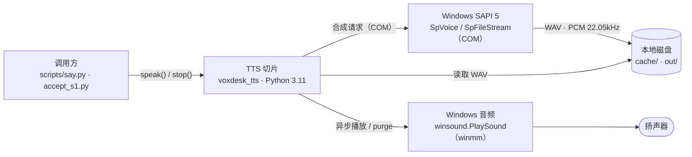
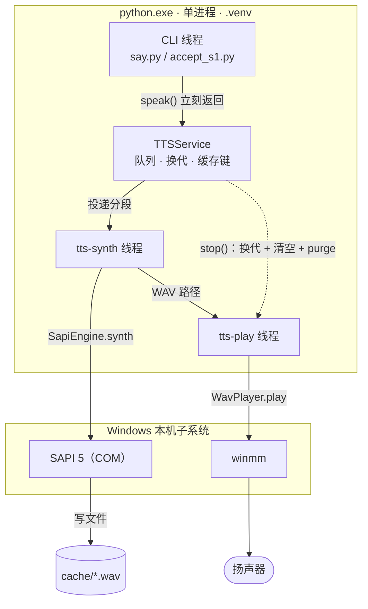
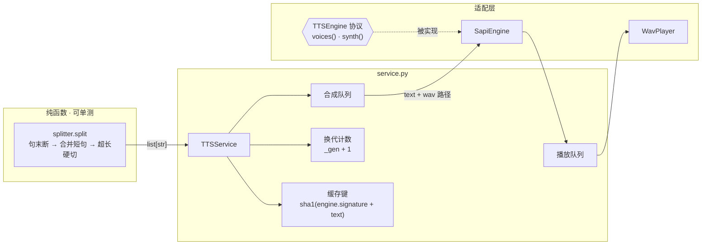

# tts · 第一个切片

> **S0 已跑通**（2026-11-04）：机器能念中文，且能合成到 WAV 落盘。
> **S1 已跑通**（2026-11-04）：分句 + 缓存 + 队列 + 打断，四项验收全过。

| 项 | 值 |
| --- | --- |
| 冲刺 | S0 · 环境与出声 → **S1 · TTS 可交付**（见文档仓 `docs/12-process.md`） |
| 引擎 | Windows SAPI 5（`pywin32`）；S2 换 Piper 时只改 `engine.py` |
| 解释器 | Python 3.11.17（uv 管理，落在 `D:\uv-python\`） |
| 依赖 | `pywin32==312`；开发依赖 `pytest==9.2.0` |
| 测试 | 13 个单测（切句 + 队列/缓存），`uv run pytest -q` |

---

## 已实现的 C4 图

**这张图的第一条规则：图里出现 = 代码里存在。** 计划中但没写的东西不进图，只进 §3.4 的表。
所以这三张图会随代码长，而不是随想法长——它们能当"实现进度"用。

### 3.1 `CTX-07` · 上下文（已实现）

它跟谁打交道。**没有网络节点、没有云端**，因为现在真的没有。



**读法**：两个 Windows 子系统分工明确——**SAPI 只负责合成**（写 WAV），**winmm 只负责播放**。
把它们画成一条线是错的，这也是 S1 打断能做成的前提：播放受我们自己的线程控制。

### 3.2 `C4-07` · 运行容器（已实现）

进程与线程边界。整个切片是**一个 `python.exe` 进程**，没有服务、没有端口。



**读法**：三个线程各司其职——CLI 只投递，`tts-synth` 只合成，`tts-play` 只播放。
`stop()` 不阻塞等待，它改代号（generation）让队列里的旧任务自然作废。

### 3.3 `C3-07` · 代码组件（已实现）

模块与类，以及唯一那个可替换点。



**读法**：六边形是 `TTSEngine` 协议——**全仓唯一的可替换点**。
`service.py` 只认协议不认 SAPI，所以 S2 加 `PiperEngine` 时它一行不改。
`splitter` 是纯函数，因此可以脱离声卡猛测（9 个用例）。

### 3.4 未实现（刻意不画）

| 计划 | 属于 | 会出现在图里的条件 |
| --- | --- | --- |
| `PiperEngine`（`piper1-gpl`） | S2 | 模型下载完、`accept_s1.py` 在 Piper 上跑通 |
| 流式合成 `synth_chunks()` | M6 | 接 CosyVoice 时才需要（`docs/09` §3.3） |
| 与 `CMP-02` 会话网关的对接 | M2 | 上层打通后，`TTSService.speak()` 变成 `IF-05` 的一个实现 |
| 缓存淘汰策略 | M2 之后 | 缓存目录真的涨到影响磁盘时 |

> 这张表是"想法的坟场"：想加功能先写在这里，等真写完了再挪进图。

---

## 实测

| 项 | 结果 |
| --- | --- |
| B-1 分句 | 445 字 → **10 段**，最长 46 字，无内容丢失 |
| B-2 首音 | 冷启动中位数 **91ms**（72–109ms）；缓存命中 **1ms** |
| B-3 打断 | `stop()` 后 **38.8ms** 静音（判据 300ms） |
| B-4 缓存 | 同一句第二轮**合成 0 段**，命中 1 段 |
| 合成速度 | 22.05 kHz / 16 bit / 单声道，实时因子 **0.009** |

## 怎么跑

```powershell
cd D:\VoxDesk\tts
uv sync

# 单句测试
uv run python scripts/speak_once.py --voice "Huihui"

# 整段播报（分句 + 缓存 + 队列）
uv run python scripts/say.py --text "第一句。第二句。第三句。" --stats

# 长文本 + 中途打断
uv run python scripts/say.py --file note.txt --stop-after 1.5

# 验收（四个可测项，会出声）
uv run python scripts/accept_s1.py

# 单测（不出声）
uv run pytest -q
```

## 结构

```
tts/
├─ src/voxdesk_tts/
│  ├─ splitter.py   切句：句末断 → 合并短句 → 超长硬切（纯函数，最好测）
│  ├─ engine.py     TTSEngine 协议 + SapiEngine（S2 换引擎的唯一开关）
│  ├─ player.py     WavPlayer：异步播放 + 10ms 轮询取消
│  ├─ service.py    队列 + 缓存 + 换代（generation）+ 统计
│  ├─ sapi.py       COM 封装（枚举 / 朗读 / 合成）
│  └─ console.py    UTF-8 控制台
├─ scripts/         probe_voices / speak_once / to_wav / say / accept_s1
├─ tests/           test_splitter.py（9 个）+ test_service.py（4 个）
├─ cache/           合成缓存（gitignore）
└─ out/             临时产物（gitignore）
```

## 三个设计选择（都不是随手写的）

### 1. 换代（generation）而不是"取消任务"

每次 `speak()` 把 `_gen + 1`，队列里的旧任务带着旧代号。播放线程看到代号不匹配就丢弃。
好处：`stop()` 不需要真去取消一个正在合成的任务（SAPI 没有取消接口），结果自然作废。

### 2. 合成线程与播放线程分开

播放第一段的同时，第二段已经在合成。所以句与句之间没有"合成 - 播放 - 合成"的空档。

### 3. 打断用"异步播放 + 轮询"，不是"同步播放 + SND_PURGE"

文档 `09` §7 的骨架写的是同步播放 + 另线程 `SND_PURGE`。**实测这条路走不通**：

```
同步播放，0.5s 时从另一线程 SND_PURGE
→ PlaySound 阻塞时长 4.55s（音频全长 4.40s），压根没停
```

原因：`SND_PURGE` 只停**调用线程自己**的发声。所以改成异步播放 + 10ms 轮询取消标志，
在**同一个线程**里 purge，实测静音延迟 38.8ms。

## 两个踩过的坑

1. **`Win32 exception occurred releasing IUnknown`**：SAPI 是 COM，`SpVoice` 必须在 `CoUninitialize()` 之前释放。解法：把所有 COM 引用关进 `_collect` / `_speak` / `_synth` 的栈帧。
2. **中文乱码**：Python 默认 cp936 输出、PowerShell 按 UTF-8 解码。解法：`enable_utf8()`。

## 已知限制

| 限制 | 影响 | 何时解决 |
| --- | --- | --- |
| 中文只有 `Huihui Desktop` | 听感机械、无男声 | S2 换 Piper（`zh_CN-huayan`） |
| SAPI 输出 22.05 kHz | 音质上限低 | S2 |
| 没有流式合成接口 | 单段最长 50 字，仍要等这一段合成完 | M6 接 CosyVoice 前 |
| `stop()` 后不保留"已播到哪" | 只能重播整段 | M2 接对话时不重要（一句话级别） |

## 下一步（S2）

`PiperEngine` 实现 `TTSEngine`，调用方零改动；验"拔网线仍能播"。
**做完后，§3.3 的六边形下面会多一个实心节点，§3.4 的表会少一行。**
